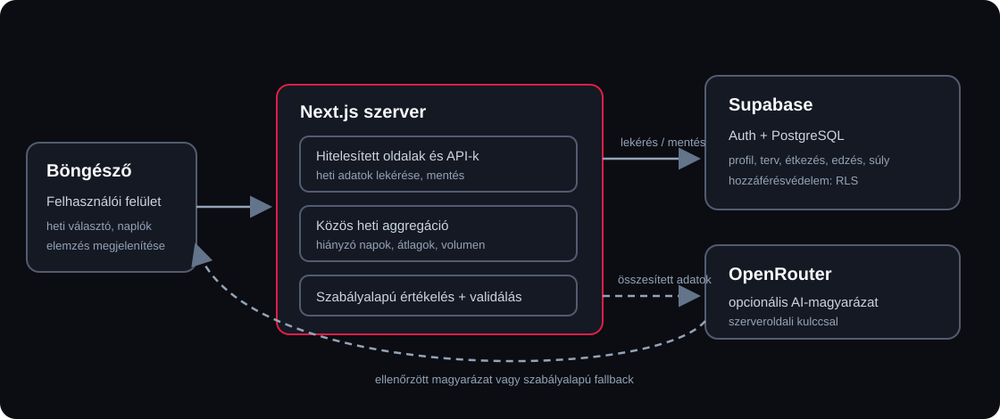
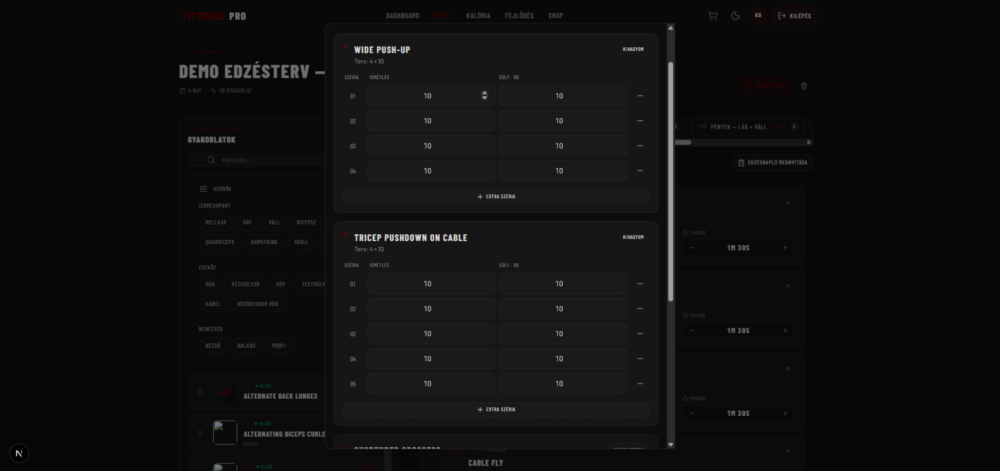
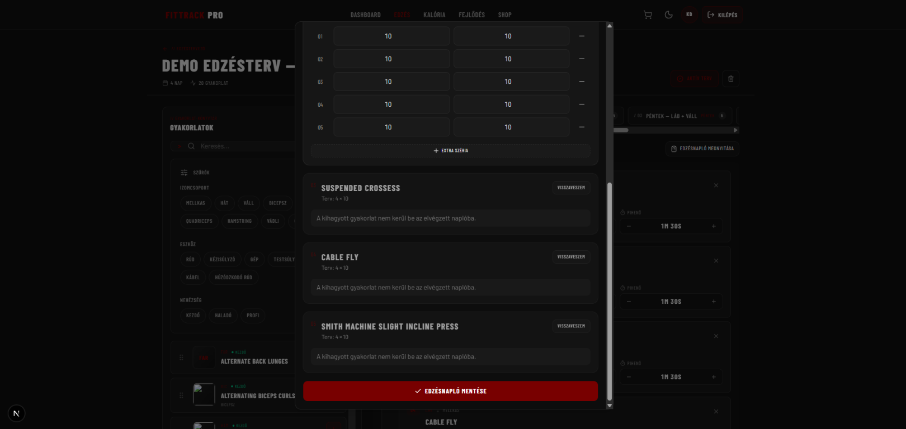

# Személyre szabott edzés- és táplálkozáskövető webalkalmazás fejlesztése
## Heti fejlődéselemzés strukturált naplóadatok és nagy nyelvi modell felhasználásával

**Szakdolgozat II. – első tartalmi munkaváltozat, bővítve 2026. november 17-én**

**Szerző:** Almási Péter  
**Neptun-kód:** BC0GZD  
**Intézmény / kar / szak:** [kitöltendő a kari sablon szerint]  
**Témavezető:** Dr. Bilicki Vilmos

> Ez a munkakézirat bevezetést, elméleti hátteret, követelményelemzést, rendszertervezési és megvalósítási leírást, valamint a jelenleg rögzíthető teszteredményeket tartalmaz. A kézi tesztelés még folyamatban van: a később végrehajtott black-box esetek eredményeit és képernyőképeit a tesztjegyzőkönyv alapján kell majd beépíteni. Ez még nem az 50 oldalas, kari Word-sablonra tördelve ellenőrzött végleges dokumentum; a fejezeteket a hallgatónak a saját megvalósításával össze kell vetnie.

---

## 1. Bevezetés

### 1.1. A probléma és indokoltsága

Az edzés és a táplálkozás tudatos követése több, egymással összefüggő adat rendszeres rögzítését igényli. Egy edzés értékeléséhez önmagában kevés annak ismerete, hogy a felhasználó megnyitott-e egy edzéstervet vagy bejelölte-e az edzést teljesítettként. A tényleges munkáról a gyakorlatok, az elvégzett sorozatok, az ismétlésszámok és az alkalmazott súlyok adnak részletesebb képet. A táplálkozási naplóban eközben az elfogyasztott ételek és azok tápértékei jelennek meg, a testsúlynapló pedig különböző időpontok méréseit tartalmazza. A felhasználónak ezekből kell megértenie, hogyan viszonyul a tényleges tevékenysége a saját céljához.

A nehézséget nem kizárólag az adatok mennyisége jelenti. A naplók gyakran hiányosak: előfordulhat, hogy egy napra nem került étkezés, egy tervezett gyakorlatot kihagytak, vagy csak egyetlen testsúlymérés áll rendelkezésre. Ha a hiányzó étkezési napokat nulla kalóriaként kezeljük, az átlag lefelé torzul. Ha a megtervezett edzést azonosnak vesszük a ténylegesen elvégzett edzéssel, akkor a teljesítési mutató nem tükrözi a naplót. Rövid adatsorból pedig nem indokolt tartós testsúlytrendet állítani. A rendszernek ezért különbséget kell tennie a hiányzó adat, a rögzített nulla érték, a terv és a tényleges teljesítés között.

A projekt kiinduló értéke az, hogy az edzéstervet, az edzésnaplót, a táplálkozási bejegyzéseket és a testsúlyméréseket közös heti nézetben kapcsolja össze. Így a felhasználónak nem kell külön felületekről kézzel összegyűjtenie az összehasonlításhoz szükséges adatokat. A rendszer nem állítja, hogy a piacon elérhető más alkalmazásoknál általánosságban jobb; a dolgozat vizsgált hozzájárulása a FitTrack Pro-ban megvalósított, adatokkal visszaellenőrizhető heti összesítés és az arra épített magyarázat.

A témavezető a projekt szakmai fókuszát a különálló modulok további bővítése helyett a személyes cél, a tényleges edzés, a táplálkozás és a testsúlyváltozás összekapcsolásában jelölte meg [6]. Ennek megfelelően a webshop a működő alkalmazás kiegészítő része, de nem a jelen dolgozatrész központi vizsgálati tárgya. A vizsgált fő felhasználói folyamat a személyes célok és terv kialakításától a naplózáson át a heti értékelés megtekintéséig tart.

### 1.2. Célkitűzés és vizsgálati kérdések

A dolgozat célja a FitTrack Pro olyan változatának megtervezése, megvalósítása és ellenőrizhető bemutatása, amely egy regisztrált felhasználó saját adataiból heti összesítést készít az edzésteljesítésről, az étkezési napló lefedettségéről, a kalória- és fehérjebevitelről, valamint a testsúlymérésekről. Az összesítéshez egy determinisztikus szabályalapú értékelés társul. Elérhető külső nyelvimodell-szolgáltatás esetén a rendszer ehhez külön AI által készített magyarázatot és következő heti javaslatokat is megjelenít.

A dolgozat a következő kérdéseket vizsgálja:

1. Hogyan lehet az edzéstervből, a tényleges edzésnaplóból, az étkezésekből és a testsúlymérésekből egységes, kézzel is ellenőrizhető heti mutatókat előállítani?
2. Hogyan kezelhetők a hiányzó vagy részleges naplóadatok úgy, hogy ne keveredjenek össze a nulla értékkel, és ne vezessenek félre a heti átlagok?
3. Milyen magyarázó többletet adhat a strukturált adatokból készített AI-válasz a szabályalapú összefoglalóhoz képest, és milyen működési, biztonsági és adatminőségi korlátokat kell bemutatni?

A dolgozatban az alkalmazás AI-funkcióját nem egészségügyi döntéshozóként kezelem. A vizsgálat tárgya az, hogy a nyelvi modell mennyire érthetően fogalmazza meg a rendszerben már összesített adatokat, és mennyire követi a megadott korlátokat. A nyers naplóadatok és a számított mutatók ellenőrizhetősége fontosabb, mint a modell szövegének meggyőző hangzása.

### 1.3. A rendszer hatóköre és korlátai

A dolgozat fő területe a profilhoz és célhoz kötött heti edzés- és táplálkozáskövetés, a részletes edzésnapló, a testsúlyadatok összesítése, valamint a szabályalapú és AI-alapú visszajelzés összevetése. A felhasználó gyakorlatokból edzéstervet állíthat össze, naplózhatja a tényleges sorozatokat, ismétléseket és súlyokat, étkezési adatokat rögzíthet, továbbá testsúlyméréseket vehet fel. A fejlődésoldal a kiválasztott hetet és az azt megelőző két hetet hasonlítja össze; a folyamatban lévő időszakot részleges hétként jelöli.

A rendszer célértékeket becsül a profil megadott adataiból, de ezek nem klinikai mérések. A felület és az AI-kimenet nem helyettesít orvosi, dietetikusi vagy edzői tanácsadást. A rövid vagy hiányos napló nem teszi lehetővé az egészségi állapotra vonatkozó következtetést. A webshop, a fizetési folyamat, valamint az automatikus edzésterv-módosítás nem tartozik e dolgozatrész fő értékelési körébe.

## 2. Elméleti háttér és szakmai alapok

### 2.1. Önmérések és digitális visszajelzés

Az önkövetés során a felhasználó rendszeresen adatot rögzít saját tevékenységéről, majd ezekből az adatokból következtetést von le a céljaihoz viszonyított állapotról. Egy edzés- és táplálkozáskövető alkalmazásban a felhasználó által felvitt bejegyzések nem közvetlen fiziológiai mérések: azt mutatják, hogy mi került rögzítésre. A megfigyelés megbízhatóságát ezért befolyásolja a napló teljessége, a bevitt értékek pontossága és a rögzítés rendszeressége. Az alkalmazás tervezésekor a „nincs adat” állapotot külön kell kezelni a nulla értéktől, és az értékelésben láthatóvá kell tenni a napló lefedettségét.

A digitális visszajelzés hatásáról szóló eredmények nem támasztják alá azt az egyszerű állítást, hogy bármely alkalmazás önmagában javítja a felhasználó állapotát. A SMARTER randomizált vizsgálatban 502 felnőtt vett részt, akik étkezési, aktivitási és testsúlyadatokat követtek; az egyik csoport a naplózás mellett személyre szabott telefonos visszajelzést is kapott. Tizenkét hónap után a két csoport testsúlyváltozása között nem volt statisztikailag szignifikáns különbség, ugyanakkor az üzenetek nagyobb megnyitási aránya együtt járt a kalóriacélhoz való jobb havi igazodással és a nagyobb súlyváltozással [10]. A vizsgálat arra mutat rá, hogy a naplózás, a visszajelzés és a tényleges felhasználói aktivitás összefügg, de az eredmény nem tulajdonítható egyetlen felületi funkciónak, és nem vihető át közvetlenül a FitTrack Pro használóira.

Raber és munkatársai 59, túlsúllyal vagy elhízással élő felnőtteknek szóló viselkedéses programot áttekintő szisztematikus vizsgálata többféle naplózási módot és eltérő intenzitást talált. A tanulmányok többségében a programok súlycsökkenést mutattak a kontrollcsoporthoz képest, de az eltérő adherenciamérések és a naplóhasználat, illetve a kimenetek közötti kapcsolat korlátozott elemzése miatt a módszerek közvetlen összevetése nem volt megbízható [13]. Ez a korlát a FitTrack Pro értelmezésében is lényeges: a „6/7 nap naplózva” adat a megfigyelés teljességét jelzi, de önmagában nem bizonyítja, hogy a naplózás vagy a heti visszajelzés egészségügyi eredményt okozott.

Ebből a dolgozat szempontjából két tervezési következmény adódik. Egyrészt a heti értékelésnek jeleznie kell, hogy hány nap adata áll rendelkezésre; másrészt a visszajelzésnek az adott naplóhoz kell kötődnie, és nem szabad több bizonyosságot sugallnia annál, mint amit az adatok indokolnak. A FitTrack Pro ezért a heti mutatókat önmagukban is megjeleníti, az AI-magyarázatot pedig kiegészítő rétegként kezeli.

### 2.2. Edzésnapló, gyakoriság és terhelésmutatók

Az edzésterv és az edzésnapló eltérő kérdésekre válaszol. A terv azt rögzíti, hogy a felhasználó mit szándékozott elvégezni; a napló a ténylegesen végrehajtott gyakorlatokat és sorozatokat tartalmazza. A heti teljesítés számításához ezért nem elegendő a tervezett edzésnapok darabszámát megmutatni: a ténylegesen teljesített alkalmat külön adatként kell nyilvántartani. Részletesebb összehasonlításhoz a gyakorlat, a sorozat, az ismétlésszám és az alkalmazott terhelés szintjén kell adatot gyűjteni.

A FitTrack Pro egyik leíró mutatója a naplózott volumen, amelyet a rendszer a sorozatonkénti ismétlésszám és a rögzített súly szorzatösszegeként számít. Ez reprodukálható összehasonlító adatot ad az alkalmazásban, de nem azonos egy teljes edzésprogram élettani terhelésének vagy izomadaptációjának mérésével. A gyakorlatok biomechanikai eltérései, a mozgástartomány, a végrehajtás módja és az erőkifejtés nem jelennek meg ebben az egyetlen összegben.

Heaselgrave és munkatársai 49, ellenállásos edzésben tapasztalt férfival végeztek hathetes randomizált vizsgálatot, amelyben heti 9, 18 vagy 27 bicepszsorozatot hasonlítottak össze. Mindhárom csoport izomvastagsága és egyismétléses maximális ereje nőtt; a csoportok közötti különbségek az elsődleges izomvastagság- és erőmutatóknál nem voltak szignifikánsak [9]. A vizsgálat egy meghatározott izomcsoportra, résztvevőkre és időszakra vonatkozott, ezért nem ad univerzális heti volumenreceptet. A dolgozatban azért releváns, mert alátámasztja a volumen mint naplózható és összehasonlítható adat használatát, miközben megmutatja, miért nem helyes ebből közvetlenül egészségi vagy fejlődési állítást levonni.

A rendszer ezért a tényleges szetteket és a súlyokat rögzíti, de a heti volumenre vonatkozó szöveget leíró statisztikaként kezeli. A szabályalapú és AI-alapú visszajelzés nem állítja, hogy a volumen növekedése önmagában bizonyítja a fejlődést. A kihagyott gyakorlat külön állapota szintén fontos: ha a kihagyás nulla ismétléssel vagy hiányzó sorral lenne összemosva, a terv és a tényleges edzés közötti különbség nehezebben lenne visszaellenőrizhető.

### 2.3. Táplálkozási napló és becsült célértékek

Az étkezési önkövetésben a termék kiválasztása és az adag megadása egymásra épül. Az adatbázisban szereplő tápérték jellemzően szabványos mennyiségre, például 100 grammra vonatkozik; a tényleges bejegyzéshez az elfogyasztott grammértéket kell társítani. Az arányosítás egyszerű számítási feladat, de csak akkor ad használható eredményt, ha a kiválasztott termék és a kiinduló tápérték is megfelelő.

Az Open Food Facts nyílt, közösségi termékadatbázisként működik, amelyben terméknevek, összetevők, allergének és címkéről származó tápértékek találhatók [12]. A közösségi adatgyűjtés hozzáférhetővé tesz sok terméket, ugyanakkor a rekordok teljessége és a termékmegnevezések minősége eltérhet. A FitTrack Pro ezért a keresési találatot és a grammra számított előnézetet mutatja meg mentés előtt; a felhasználó felel a termék és az adag kiválasztásáért. A kereső szolgáltatói válasza nem tekinthető laboratóriumi mérésnek.

Egy 57 résztvevős, 12 hetes randomizált vizsgálat mobilalkalmazásban, illetve papíralapú naplóban történő étkezésrögzítést hasonlított össze. A két csoport testsúly- és BMI-változása között nem találtak statisztikailag szignifikáns különbséget [14]. Az eredmény nem azt mutatja, hogy az alkalmazások általában hatástalanok, hanem azt, hogy az adatbevitel digitális módja önmagában nem garantál mérhető testsúlykimenetet. A vizsgálat FitTrack Pro-ra történő közvetlen átvitele sem indokolt: a minta kicsi, a beavatkozás és a résztvevői kör sajátos, a jelen dolgozat pedig a szoftver adatkezelését vizsgálja, nem testsúlycsökkentő program hatásosságát.

A napi energiaigény meghatározása szintén becslés. A dolgozat későbbi rendszertervezési része a profiladatokból kiinduló Mifflin–St Jeor-számítást mutatja be [7]. Az egyenletből származó nyugalmi energiafelhasználás és az aktivitási szintből számított célérték nem veszi figyelembe automatikusan minden felhasználó egyéni körülményét. A rendszer ezért az értéket becsült célként jeleníti meg, a heti tényleges átlagot pedig csak rögzített napokra számítja. Ha a naplóban öt rögzített étkezési nap és két hiányzó nap van, a kalóriaátlag az öt megfigyelt nap alapján készül; a lefedettség külön 5/7 napként látszik. Ez elkerüli, hogy az adat hiányát nulla bevitelként értelmezzük.

### 2.4. Szabályalapú és generatív MI-visszajelzés

A szabályalapú döntés és a generatív MI különböző feladatokra alkalmas. A szabályalapú függvény azonos bemenetre azonos kimenetet ad, feltételei unit tesztekkel lefedhetők, és az eredmény közvetlenül összekapcsolható a mutatókkal. A nyelvi modell rugalmasabb összefoglalót fogalmazhat, de a válasz tartalma nem garantáltan determinisztikus, a szolgáltató működése külső függőség, a szöveg pedig félrevezető lehet. Emiatt a nyelvi modell nem végezheti el ellenőrizetlenül a rendszerben fontos számításokat.

A FitTrack Pro a megközelítést két rétegben valósítja meg: először szabályalapú értékelés készül az aggregált heti adatokból, majd – ha a külső szolgáltatás használható – erre épülhet az AI-magyarázat. A modell kimenete mező-, pontszám- és nyelvi validáción megy át. Hibás válasz vagy szolgáltatói hiba esetén a determinisztikus eredmény marad elérhető, és az adatbázis a létrejött elemzés állapotát is tárolja.

Az MI egészséggel összefüggő alkalmazásakor az etikai, emberi jogi és elszámoltathatósági szempontokat már a tervezés és a használat során figyelembe kell venni – ezt hangsúlyozza az Egészségügyi Világszervezet iránymutatása is [11]. A FitTrack Pro nem klinikai döntéstámogató rendszer: nem diagnosztizál, nem állít fel sérüléskezelési tervet, és nem módosítja automatikusan a felhasználó edzéstervét. A figyelmeztetés, a szabályalapú tartalék, az eredetjelölés és a felhasználói kontroll ennek a projektben alkalmazott, szűkített kockázatkezelésnek az elemei. Ezek nem jelentik azt, hogy az alkalmazás bármely egészségügyi felhasználásra validált lenne.

### 2.5. A szakmai háttér kapcsolata a rendszer követelményeivel

A fenti kutatási eredmények és technikai korlátok a dolgozatban nem közvetlen termékhatás-ígéretként szerepelnek. A rendszer a naplózás következetességét, a heti időszakok összehasonlíthatóságát és az összesítés magyarázhatóságát támogatja. Nem állítja, hogy a megjelenített javaslat önmagában megváltoztatja a felhasználó viselkedését, vagy hogy a naplózott volumen és táplálkozási átlag klinikai következtetésre alkalmas.

Ennek megfelelően a követelmények között szerepel a tervezett és végrehajtott edzés külön tárolása, a részletes sorozatnapló, az étkezési és testsúlyadatok hetes aggregálása, a hiányzó adatok látható jelzése, valamint az AI-válasz determinisztikus tartaléka. A későbbi értékelés feladata annak ellenőrzése, hogy ezek a követelmények a felületen és az adatbázisban is teljesülnek-e; a dolgozat nem használja fel a szakirodalmat a még el nem végzett felhasználói tesztek helyettesítésére.

## 3. Követelményelemzés

### 3.1. Szereplők és használati környezet

Az elsődleges szereplő a regisztrált felhasználó. Böngészőből eléri a saját profilját, edzéstervét, napi naplóit és fejlődési adatait. A felhasználó maga felel azért, hogy a rögzített étkezések és edzések a valós tevékenységét tükrözzék; az alkalmazás a megadott adatokból számol, és nem tudja ellenőrizni, hogy egy bejegyzés teljes-e.

Másodlagos szereplő az üzemeltető vagy fejlesztő, aki konfigurálja a Supabase projektet, alkalmazza az adatbázis-migrációkat, kezeli a mintaadatok létrehozását és szerveroldalon megadja a külső AI-szolgáltatás kulcsát. A gyakorlatkatalógus importált adatokat tartalmaz [5]. Az Open Food Facts szolgáltatás termékkeresési függőség, az AI-elemzés pedig az OpenRouter API-ján keresztül éri el az aktuálisan konfigurált nyelvimodell-szolgáltatót [3, 4]. Ezek elérhetősége és válaszformátuma nem a FitTrack Pro irányítása alatt áll.

### 3.2. Fő használati esetek

**HK-01 – Heti fejlődés áttekintése.** Előfeltétel a bejelentkezett felhasználói munkamenet. A felhasználó megnyitja a fejlődés oldalt, kiválaszt egy hetet, majd megtekinti az adott hét és az előző hét edzés-, táplálkozási és testsúlymutatóit. Ha nincs étkezési adat, az alkalmazás nem jelenít nulla kalóriát átlagként, hanem jelzi a naplólefedettséget. Ha nincs elegendő testsúlymérés, nem állít heti változást. Alternatív eset, hogy korábbi hét kiválasztásakor kevés adat áll rendelkezésre; ilyenkor az elérhető mérőszámok jelennek meg, a hiányzókat pedig adat hiányaként kell jelezni.

**HK-02 – Edzés rögzítése.** Előfeltétel egy aktív terv és az ahhoz tartozó edzésnap. A felhasználó megnyitja a naplózót, ellenőrzi vagy módosítja a tervezett gyakorlatok sorozatait, ismétléseit és súlyait, szükség esetén extra sorozatot ad hozzá, illetve kihagyottként jelöl egy gyakorlatot. Mentés után az adatok visszanézhetők. Sikertelen mentésnél a felületnek hibát kell jeleznie, és lehetőséget kell adnia az újrapróbálkozásra. A kihagyott gyakorlat nem számíthat bele az elvégzett volumenbe.

**HK-03 – Heti elemzés kérése.** Előfeltétel a hitelesített felhasználó és az aktuális hétre összegyűjthető adat. A szerver kiszámítja a heti mutatókat és a determinisztikus alaperedményt, majd megkísérli az AI-értékelés elkészítését. Siker esetén a kétféle eredmény egymás mellett jelenik meg. Külső szolgáltatási hiba vagy hibás AI-válasz esetén a szabályalapú összefoglaló marad használható, a korlátozott állapotot pedig jelezni kell. Ha az aktuális hétre már van elemzés, az ismételt kérés nem hozhat létre észrevétlenül duplikált eredményt.

**HK-04 – Regisztráció és profil befejezése.** Szereplő a vendégből regisztrált felhasználóvá váló személy; előfeltétel, hogy még nincs bejelentkezett munkamenete. Regisztráció után a felhasználó megadja az energiaigény-becsléshez kötelező profiladatokat, majd menti az űrlapot. Hiányzó mezőnél a felület jelzi a pótlást, mentési vagy hálózati hibánál az adat nem tekinthető elmentettnek, és a felhasználó újrapróbálhatja. Siker esetén a teljes profil a további védett oldalak használatát teszi lehetővé.

**HK-05 – Edzésterv létrehozása vagy módosítása.** Szereplő a bejelentkezett felhasználó; előfeltétel az elérhető gyakorlatkatalógus. A felhasználó tervet hoz létre vagy nyit meg, edzésnapokat és gyakorlatokat rendel hozzá, majd menti a változtatásokat. Érvénytelen vagy üres tervadatnál a felület hibát jelez; mentés után a felhasználó másik oldalra navigálva és frissítés után is visszanyithatja a tervet. A mentett terv adja a tervezett edzésalkalmak alapját.

**HK-06 – Étkezés rögzítése.** Szereplő a bejelentkezett felhasználó; előfeltétel egy dátumhoz tartozó napi napló. A felhasználó ételre keres, kiválaszt egy találatot, megadja az elfogyasztott adagot, ellenőrzi az arányosított tápértéket, majd elmenti az étkezést. Üres keresési eredmény vagy külső szolgáltatói hiba esetén a kereső ezt jelzi; érvénytelen adag vagy sikertelen adatbázismentés esetén nem jelenhet meg hamis sikervisszajelzés. Sikeres mentés után az étel a megfelelő étkezésnél és a napi összesítőben is látható.

**HK-07 – Testsúlymérés rögzítése.** Szereplő a bejelentkezett felhasználó; előfeltétel a fejlődésoldal elérése. A felhasználó dátumot és mérési értéket ad meg, majd menti a mérést. Hibás érték vagy dátum esetén javítási visszajelzést kap; sikeres mentés után az érték a megfelelő hét mérési darabszámában és átlagában jelenik meg, majd frissítés után visszaolvasható. Összehasonlítható heti mérés hiányában a rendszer nem állít testsúlyváltozást.

### 3.3. Funkcionális követelmények

| Azonosító | Prioritás | Követelmény | Elfogadás ellenőrzése |
|---|---|---|---|
| K-01 | P0 | A felhasználó regisztrálhat, bejelentkezhet, és csak hitelesítés után használhatja a védett napló- és fejlődésfunkciókat. | Kézi bejelentkezési próba és jogosulatlan kérés ellenőrzése. |
| K-02 | P0 | A profil tárolja a cél- és energiaigény-becsléshez szükséges adatokat; a felhasználói cél jelenjen meg a heti értékelés bemenetében. | Profiladatok ellenőrzése és célérték számításának tesztesetei. |
| K-03 | P0 | A felhasználó aktív heti tervet állíthat össze gyakorlatokkal és edzésnapokkal. | Terv mentése, újranyitása és tervnapok megjelenése. |
| K-04 | P0 | Az edzésnapló sorozatonként tárolja a tényleges ismétlést és súlyt, támogatja az extra sorozatot és a gyakorlat kihagyását. | Mentés utáni újranyitás; a kihagyás és a volumen hatásának ellenőrzése. |
| K-05 | P0 | A felhasználó napi étkezéseket és azok tápértékadatait rögzítheti, valamint élelmiszerre kereshet. | Étkezés mentése és megjelenése a napi, illetve heti nézetben. |
| K-06 | P0 | A felhasználó dátumhoz kötött testsúlyméréseket rögzíthet. | Mérés mentése, dátum szerinti megjelenése és heti átlag ellenőrzése. |
| K-07 | P1 | A fejlődésoldalon hét választható; a kiválasztott hét és az azt megelőző két hét összehasonlítható adatai jelennek meg. | A demo hetek és egy korábbi hét kiválasztása, valamint a három időszak dátumainak ellenőrzése. |
| K-08 | P1 | A heti összesítő a kiválasztott hetet és az azt megelőző két hetet azonos mutatókkal hasonlítja össze: naplózott edzések, részletes volumen, étkezési lefedettség, kalória- és fehérjeátlag, valamint testsúlymérések. A még tartó hetet részleges időszakként jelöli. | A seeded teszthetek eredményeinek kézi újraszámítása, a három panel és a hétválasztás ellenőrzése. |
| K-09 | P1 | A rendszer a heti adatokból determinisztikus szabályalapú összefoglalót állít elő; AI elérhetősége esetén külön magyarázat is készül. | Azonos bemenet ismételt szabályalapú számítása, majd AI-eredmény ellenőrzése. |
| K-10 | P1 | AI-hiba vagy nem feldolgozható válasz esetén a szabályalapú értékelés maradjon elérhető, és a felület jelezze az AI állapotát. | Szolgáltatási hibát szimuláló tesztkörnyezetben fallback ellenőrzése. |
| K-11 | P1 | A korábbi heti elemzések visszakereshetők, dátumuk és eredetük azonosítható. | Előzménylista és minta-, szabályalapú, valamint AI-állapot ellenőrzése. |

A P0 jelölés az elsődleges felhasználói folyamat működéséhez szükséges követelményt, a P1 a heti összehasonlítás és értékelés szempontjából fontos funkciót jelöli. A követelményekhez rendelt elfogadási ellenőrzések a későbbi tesztjegyzőkönyv alapját adják; a táblázat nem állítja, hogy minden ellenőrzést már végrehajtottunk.

### 3.4. Minőségi követelmények, függőségek és korlátok

| Terület | Elvárás és ellenőrizhetőség |
|---|---|
| Adatkonzisztencia | A képernyőn látható heti mutatók és az elemzés bemenete azonos aggregációból származzon. Eltérő bemeneti adatok nélkül a szabályalapú eredmény legyen reprodukálható. |
| Hiányos adatok | A naplózatlan étkezési nap ne kerüljön nulla kalóriaként az átlagba. A lefedettség legyen látható; hiányzó testsúlytrend esetén a felület ne mutasson számított változást. |
| Hozzáférésvédelem | A védett adatokat hitelesítés és adatbázis-szintű RLS szabályozza. A jogosulatlan felhasználó ne férjen hozzá más profiljához vagy naplóihoz. |
| Titkok kezelése | Az OpenRouter- és Supabase emelt jogosultságú kulcsok szerveroldali környezetben maradjanak; ne kerüljenek klienskódba vagy a repositoryba. |
| Külső szolgáltatások | A Supabase, az Open Food Facts és az OpenRouter elérhetősége, korlátozásai és válaszai függőséget jelentenek. AI-hiba esetén a fő heti összesítő maradjon használható. |
| Használhatóság | A fő naplózási és heti áttekintési folyamat legyen magyar nyelvű, visszajelzést adó és különböző képernyőméretekre alkalmas. A reszponzivitást és az üres/sikeres/hibás állapotokat kézi felhasználói próbával kell dokumentálni. |
| Biztonságos értelmezés | A célértékek becslések; az AI nem adhat diagnózist, sérüléskezelési útmutatást vagy szélsőséges diétás javaslatot. Hiányos adatoknál a bizonytalanságot jelezni kell. |

A fő működési kockázat az adatok teljessége: a rendszer nem tud következtetni arra, amit a felhasználó nem rögzített. További függőség a külső AI-modell és annak szolgáltatója; a modellkatalógus, a hozzáférés és az esetleges díjazás változhat. Ezért az alkalmazás az AI-t nem tekinti a számított mutatók forrásának, és nem teszi az AI-választ a naplózás vagy a heti összesítő előfeltételévé. A termékkereséshez használt külső élelmiszeradatok hiányosak vagy eltérő mértékegységűek lehetnek; az adatbevitel ellenőrzése továbbra is a felhasználó feladata.

## 4. Rendszertervezési döntések

### 4.1. Architektúra és komponenshatárok

A FitTrack Pro Next.js App Routerre, Reactre és TypeScriptre épülő webalkalmazás. A böngésző a felhasználói felületet jeleníti meg; a Next.js szerveroldali része végzi a hitelesített adatok lekérését, a szerveroldali műveleteket és a Route Handlereken keresztüli API-kéréseket. A Supabase biztosítja az adatbázist és a hitelesítést. Az OpenRouterrel való kommunikáció kizárólag a szerveroldali elemző végponton történik. Ez a megosztás az interaktív felületet elkülöníti az érzékeny adatokat és titkokat kezelő logikától [1]. A saját rendszer konkrét komponenseit és adatútját a megvalósított forráskód alapján határoztam meg [8].

Az adatút fő lépéseit a 4.1. ábra szemlélteti.

<em>4.1. ábra. A heti értékelés magas szintű adatútja (saját szerkesztés).</em>

A böngésző hitelesített kérést küld a Next.js alkalmazásnak. A szerver a Supabase-ből lekéri az adott felhasználó profilját, aktív tervét, napi naplóit, testsúlyméréseit és részletes edzésnaplóit. A közös heti aggregáció előállítja az aktuális és az előző időszak mutatóit; ezekből determinisztikus szabályalapú értékelés készül. A szerver opcionálisan az aggregált bemenetet az OpenRouternek továbbítja, majd a választ ellenőrzi és eltárolja.

A Next.js szerver- és klienskomponensei eltérő feladatot látnak el: a szerverkomponensek alkalmasak adatlekérésre és szerveroldali erőforrások használatára, míg a klienskomponensek a felhasználói interakciót, például a hétválasztást és a napló szerkesztését kezelik [1]. Az edzésnapló mentése szerveroldali műveletet vesz igénybe; a heti összesítő és az elemzés API-végponton keresztül szolgálja ki a felületet.

### 4.2. Adatmodell és hozzáférésvédelem

Az adatmodell a felhasználói profilt elválasztja a terv- és naplóadatoktól. A `profiles` táblában találhatók a célhoz és becslésekhez szükséges felhasználói adatok. A `workout_plans` aktív terve `workout_days` napokon keresztül kapcsolódik a tervezett gyakorlatsorhoz. A tényleges napi teljesítést a `daily_logs` rögzíti; ehhez kapcsolódnak a `food_entries` bejegyzések és a `workout_exercise_logs` részletes gyakorlatnaplók. A testsúlymérések külön `weight_logs` rekordok. A generált heti eredményt a `weekly_analyses` tárolja, dátummal, állapottal, strukturált válasszal és az értékeléshez használt heti adatokkal.

Ez a felosztás külön kezeli a tervezett és a ténylegesen végzett tevékenységet, valamint megőrzi azt a forrást, amelyből a heti mutató számítható. A migrációk verziózott SQL-fájlokban rögzítik a sémaváltozásokat. A seed szkript ellenőrizhető demo profilt és két lezárt teszthetet hoz létre; használata kizárólag a demo felhasználóhoz kötődő adatokat érinti, ezért éles felhasználón nem alkalmazható.

A heti elemzéshez fontosabb táblák és kapcsolataik összefoglalása:

| Adatkör | Fő táblák | Szerep a heti értékelésben |
|---|---|---|
| Felhasználó és cél | `profiles` | A személyes cél, aktivitási és célérték-becslési adatok forrása. |
| Terv | `workout_plans`, `workout_days`, `workout_day_exercises` | A felhasználó által tervezett edzésnapok és gyakorlatok leírása. |
| Napi aktivitás | `daily_logs`, `workout_exercise_logs` | A tényleges edzésalkalmak, sorozatok, ismétlések, súlyok és kihagyások naplója. |
| Táplálkozás | `food_entries` | Az étkezési tételek és azok tápértéke; a naplózott napok lefedettsége ebből számítható. |
| Testsúly | `weight_logs` | Dátumhoz rendelt mérések, amelyekből heti átlag készül. |
| Értékelés | `weekly_analyses` | A heti szabályalapú eredmény, az AI-állapot és az elemzéskor felhasznált adatok pillanatképe. |

Az elnevezett táblák nem önmagukban alkotnak elemzést: a szerver a felhasználó azonosítója és a vizsgált dátumtartomány alapján kérdezi le őket. A heti mutatók csak az adott időablakhoz tartozó rekordokból készülnek. A részletes gyakorlatnapló és a terv külön tárolása teszi lehetővé, hogy a tervezett alkalom és a végrehajtott munka összevethető legyen.

A Supabase Auth azonosítja a felhasználót, a Row Level Security (RLS) pedig adatbázis-szinten korlátozza, hogy mely sorok érhetők el. A kliensoldali felület elrejtése nem helyettesítené ezt a védelmet: a jogosultsági ellenőrzést a szervernek és az adatbázisnak is érvényesítenie kell. A projekt RLS-szabályokat tartalmaz a felhasználói táblákhoz [2]. A végleges értékelési fejezetben külön rögzíteni kell a jogosulatlan hozzáférés próbájának tényleges eredményét. A seedeléshez szükséges emelt jogosultságú kulcs nem kerülhet a böngészőbe vagy a verziókezelőbe.

### 4.3. Heti összesítés és hiányzó adatok kezelése

A heti aggregációt a `src/lib/analysis/weekly-metrics.ts` valósítja meg. Ugyanez a modul szolgálja ki a fejlődésoldal heti összesítőjét és az elemzési végpontot, így a felület és az AI-nak küldött adatok ugyanazon számítási útvonalból készülnek. A hetek hétfőn kezdődnek; a folyamatban lévő hét vége nem lehet későbbi a lekérés napjánál. A fejlődésoldal a kiválasztott hetet, az előző hetet és a két héttel korábbi időszakot jeleníti meg azonos mutatókkal. A még tartó hét „Folyamatban · részleges hét”, a korábbi teljes időszakok „Lezárt hét” jelölést kapnak. A történeti hét kiválasztásakor a kliens a `/api/progress/weekly` végponttól kéri le a kiválasztott hét és a két megelőző hét adatcsomagját; a végpont bejelentkezést, hétfői kezdődátumot és legfeljebb 52 hetes előzményt követel meg. A háromhetes megjelenítést automatizált szerveroldali renderelési teszt és Supabase adatokkal végzett API-integrációs próba ellenőrzi. Az integrációs próba igazolta a három hét visszaadását, a seedelt mutatók egyezését és a dátumvalidációt; a felület vizuális ellenőrzése és mobilnézete a tesztjegyzőkönyvben külön kézi lépésként szerepel.

Az étkezési napok száma olyan naplózott napokból áll, amelyekhez legalább egy étkezési bejegyzés tartozik. A napi kalóriamennyiségek átlaga ezekre a napokra készül, nem a teljes hétre. Például öt, egyenként 2000 kcal-t tartalmazó naplózott nap és két hiányzó nap esetén az átlag 2000 kcal, a lefedettség pedig 5/7 nap. A fehérjeátlag azon napokból készül, ahol fehérjeadat is rendelkezésre áll; ez különbözhet az étkezési napok számától.

Az edzésteljesítés az aktív terv héten belülre eső edzésnapjainak számát hasonlítja a `workout_completed` értékkel rögzített napi teljesítésekhez. A teljesített alkalmak darabszáma a terven felüli edzéseket is megőrzi, míg a tervteljesítési százalék 0–100 közé van korlátozva. Terven felüli teljesítésnél a szabályalapú összefoglaló külön megfigyelésben jelzi az alkalmak számát, de a százalékot és az értékelési pontszámot nem növeli 100% fölé. A részletes volumen a naplózott gyakorlatok ismétlésszámainak és hozzájuk tartozó súlyoknak szorzatösszege, azaz `Σ(ismétlés × súly)`. A kihagyott gyakorlatot a lekérdezés kizárja. Ez a mutató a naplózott terhelés leírására szolgál, nem az edzés élettani hatásának mérése.

A testsúly heti átlaga az adott időszakban rögzített mérésekből készül. Változás csak akkor számítható, ha a kiválasztott és az előző hét átlaga is rendelkezésre áll. A heti átlag és a mérési darabszám együtt jelenik meg, mert ugyanaz az átlag eltérő számú mérésből is előállhat.

Az összesítés döntési szabályait a 4.1. táblázat foglalja össze. A táblázat szándékosan külön kezeli a mutató értékét és azt, hogy mennyi adatból származik; ez a különbség a későbbi AI-bemenetben is megmarad.

| Mutató | Bemenet | Összesítés | Hiányos vagy szélső eset |
|---|---|---|---|
| Edzésalkalom | Aktív tervnapok és `workout_completed` naplók | Tervezett és tényleges alkalmak külön száma | A tényleges alkalomszám megmarad; a tervteljesítési arány legfeljebb 100%. |
| Edzésvolumen | Naplózott, nem kihagyott sorozatok | Ismétlés × rögzített súly összege | Kihagyott gyakorlat és be nem rögzített sorozat nem növeli. |
| Kalória | Napi étkezési tételek | Átlag a naplózott étkezési napokon | A naplózatlan nap nem számít nulla kalóriának; a lefedettség külön jelenik meg. |
| Fehérje | Fehérjeértékkel rendelkező napok | Átlag a rendelkezésre álló fehérjeadatokból | Az adat nélküli napot nem kezeli nulla grammként; naplózott napok száma eltérhet. |
| Testsúly | Dátumozott mérések | Heti számtani átlag és mérési darabszám | Két összehasonlítható heti átlag nélkül nincs változásérték. |

**4.1. táblázat. A heti metrikák adatforrása és hiányzóadat-kezelése (saját szerkesztés a megvalósított logika alapján).**

### 4.4. Kalóriacél becslése

A kalóriacél-becslés a felhasználói profilban megadott adatokból indul ki, és a Mifflin–St Jeor-egyenletet alkalmazza a nyugalmi energiafelhasználás becslésére. Az egyenletet Mifflin és munkatársai egészséges felnőttek mérési adatai alapján tették közzé [7]. A FitTrack ezt az értéket aktivitási tényezővel módosítja, majd a felhasználó céljához igazított célértéket számít. Ha az alapadatok hiányoznak, nem áll rendelkezésre megbízható személyes célérték.

A számítás célja az alkalmazáson belüli összehasonlítás támogatása, nem pedig egyéni klinikai energiaigény meghatározása. Az egyenlet becslő jellegű, és a felhasználói adatok pontossága, a tényleges aktivitás, valamint más egyéni körülmények eltérést okozhatnak. Ezért a felület a célt becslésként kezeli, a dolgozat pedig nem következtet belőle egészségügyi állapotra.

### 4.5. Szabályalapú értékelés és AI-integráció

A heti értékelés első rétege a `src/lib/analysis/rule-summary.ts` modulban megvalósított determinisztikus függvény. Az edzés teljesítési arányát, a naplózott napok lefedettségét, a kalória- és fehérjeadatokat, a részletes volument és a testsúlymérések számát alakítja rövid megállapításokká és javaslatokká. A pontszám is rögzített szabályok szerint, korlátozott tartományban készül. Ez az alap akkor is előállítható, ha a külső AI-szolgáltatás nem érhető el.

A témavezető adaptív visszajelzésre vonatkozó javaslatához a rendszer a két legutóbbi, teljesen lezárt hét tervteljesítését is figyelembe veszi. Ha mindkét héten elmaradt a teljesítés a tervtől, az értékelés felveti a heti gyakoriság fenntarthatóságának átgondolását; két teljesített hét és részletes edzésnapló esetén legfeljebb egy tényező kis lépésű módosítását javasolja. A folyamatban lévő hét nem vált ki ilyen következtetést, és az alkalmazás egyik esetben sem módosítja automatikusan a felhasználó edzéstervét.

Az elemző API hitelesítés után összegyűjti a folyamatban lévő hét, valamint a két legutóbbi teljesen lezárt hét mutatóit, előállítja a szabályalapú eredményt, majd szerveroldali kérést küld az OpenRouter chat completion végpontjára [3]. A modell bemenete strukturált heti adat; az alkalmazás rendszerutasítása előírja az adatokhoz kötött válaszadást, a kizárólag magyar nyelvű kimenetet és az egészségügyi korlátokat. A szerver a visszakapott JSON-t feldolgozza, ellenőrzi a kötelező mezőket, a pontszám tartományát és a kimenet nyelvét. A nyelvi ellenőrzés kizár bizonyos gyakori angol, spanyol és francia mintákat, figyeli a nem latin írásrendszereket, és magyar nyelvi jelzések jelenlétét várja el; ez szabályalapú szűrés, nem teljes körű nyelvfelismerés. Szolgáltatási hiba vagy hibás formátumú, illetve nem magyar válasz esetén a determinisztikus eredmény használható marad. A felület a korábban elmentett, nyelvi ellenőrzésen fennakadó AI-szöveget is a szabályalapú magyar értékeléssel helyettesíti. Az AI-válasz nem módosítja a naplóadatokat, és nem hoz létre vagy ír át edzéstervet.

E döntés előnye, hogy a nyelvi modell szöveges magyarázata összevethető a rögzített szabályokkal, miközben a számítások a modell nélkül is ellenőrizhetők. Korlátja, hogy az AI válasza nem determinisztikus, a külső szolgáltató változhat vagy kieshet, illetve a modell a korlátozó utasítások ellenére is adhat nem megfelelő szöveget. A szókészlet-alapú nyelvi szűrő sem ismer fel minden lehetséges idegen nyelvű vagy kevert megfogalmazást. Ezért a modell kimenete csak validálás után jelenhet meg; a dolgozat későbbi tesztelési fejezetében a sikeres választ és a fallbackot külön kell vizsgálni.

## 5. A rendszer megvalósítása

### 5.1. Megvalósítási környezet és rétegek

A FitTrack Pro kliens- és szerveroldali része egy Next.js App Router alkalmazásban készült, TypeScript nyelven [1, 8]. Az oldalak szerverkomponensei alkalmasak arra, hogy a bejelentkezett felhasználó adatait már a HTML előállítása előtt lekérjék. Az olyan elemek, amelyek közvetlen felhasználói interakciót igényelnek – például a hétválasztó, az edzésnapló dialógusa vagy az ételkereső adagmezője –, kliensoldali React-komponensként működnek. A módosításokat szerveroldali műveletek vagy API-útvonalak végzik, a sikeres mentések után pedig az érintett felületek újraérvényesítése frissíti a megjelenített adatokat.

A tartós adatokat a Supabase PostgreSQL adatbázisa tárolja, a felhasználói munkamenetet a Supabase Auth kezeli [2]. A szerveroldali adatbázis-kliens a kérés cookie-jaiból olvassa a munkamenetet; a kliensoldali komponens nem kapja meg a szerverhez kötött szolgáltatói titkokat. Az Open Food Facts az ételkeresés külső adatforrása [4], az OpenRouter pedig opcionális közvetítő a nyelvimodell-kéréshez [3]. A külső szolgáltatások kiesése ezért nem azonos az adatbázis vagy a teljes alkalmazás kiesésével: az ételkereső ilyenkor hibajelzést ad, az AI-értékelés pedig szabályalapú változattal is előállítható.

A repository fájlszerkezete elkülöníti az oldalakat, az újrahasználható felületi komponenseket, a szerveroldali műveleteket és a számítási logikát. A `src/app` tartalmazza az útvonalakat és API-kezelőket; a `src/components` az interaktív és megjelenítő elemeket; a `src/lib` az adatlekérdezéseket, validációkat és üzleti logikát. Az adatbázis-változások a `supabase/migrations` könyvtár időbélyeges SQL-fájljaiban követhetők. A seed scriptek külön, megismételhető demókörnyezetet készítenek [8].

### 5.2. Hitelesítés és profiladatok

A felhasználói útvonalak és a szerveroldali adatlekérések a Supabase Auth munkamenetéhez kötődnek. A Next.js proxy minden olyan kérésnél továbbítja a Supabase munkamenet-frissítést, amelyet nem statikus vagy belső Next.js-erőforrásként szolgál ki. A védett funkciók nem pusztán a kliensoldali navigáció elrejtésére támaszkodnak: a szerveroldali műveletek lekérik az aktuális felhasználó azonosítóját, a felhasználóhoz tartozó rekordokra szűrnek, az adatbázisban pedig Row Level Security (RLS) szabályok korlátozzák a hozzáférést [2, 8].

A profil teljességét külön ellenőrző függvény vizsgálja. Az onboarding befejezéséhez a nem, a testsúly, a magasság és a cél megadása szükséges; ezek nélkül a kalóriacél-becslés nem állítható elő a megvalósított szabály szerint. Az új, hiányos profillal rendelkező felhasználó ezért a védett főoldal helyett az onboarding felületre kerül. Mentés után a profiladatok adatbázisban maradnak, és a következő kéréskor az alkalmazás újra ellenőrzi a teljességet. A kiegészítő aktivitási és életkori adatok javíthatják a becslési bemenetet, de a kötelező profilkapu négy mezőt vizsgál.

### 5.3. Edzésterv és részletes edzésnapló

Az edzésterv hierarchikus adatmodellre épül. Egy tervhez (`workout_plans`) több edzésnap (`workout_days`), az edzésnapokhoz pedig tervezett gyakorlatok (`workout_day_exercises`) kapcsolódnak. A gyakorlat-adatbázisban szereplő gyakorlat kiválasztható és a terv megfelelő napjához rendelhető. A terv napjai sorrendet és – amennyiben meg van adva – a hét napját is tárolják; ezt használja a heti tervezett edzésszám számítása.

A naplózó felület a kiválasztott edzésnap tervezett gyakorlatait egy oldalsó panelben jeleníti meg. Megnyitáskor a szerveroldali művelet visszaolvassa az adott dátumhoz tartozó részletes naplót. Minden gyakorlatnál külön sorozatok rögzíthetők; egy sorozat ismétlésszámot és súlyt tartalmaz. A felhasználó további sorozatot adhat hozzá, meglévő sort törölhet, vagy a gyakorlatot kihagyottként jelölheti. Betöltési és mentési hiba esetén a felület visszajelzést jelenít meg, a mentési folyamat pedig nem tünteti el csendben a sikertelen adatot.

A mentési szerveroldali művelet hitelesített felhasználót követel meg, érvényes ISO-dátumot vár, ellenőrzi, hogy az edzésnap a felhasználó saját tervéhez tartozik-e, és azt is, hogy a beküldött gyakorlatok valóban szerepelnek-e azon az edzésnapon. Megakadályozza az ismétlődő gyakorlat-azonosítókat, a negatív vagy ésszerűtlenül nagy ismétlés- és súlyértékeket, valamint azt, hogy minden gyakorlat kihagyottként legyen elmentve. A validáció után a napi napló rekordja létrejön, a részletes gyakorlatnaplók pedig a napi napló és a gyakorlat kombinációja alapján frissülnek vagy jönnek létre.

Az elvégzett gyakorlat `sets_completed`, `reps_completed` és `weight_used` mezőket kap; a sorozatszintű ismétlés- és súlyértékek tömbökben tárolódnak. Kihagyásnál a `skipped` mező igaz, a sorozatszám nulla, a két részletes tömb pedig üres. Ez a tárolási forma megkülönbözteti a kihagyást a hiányzó naplótól, és a heti aggregációban lehetővé teszi, hogy a kihagyott gyakorlat ne növelje a volument. A mentés az edzésnaphoz tartozó napi napló `workout_completed` állapotát is frissíti. A felhasználó később ugyanazt a dátumot megnyitva visszakapja a rögzített sorozatokat és kihagyásokat [8].

Az 5.1. ábra a sorozatszintű rögzítőfelületet, az 5.2. ábra pedig a kihagyott állapot visszajelzését mutatja egy demó edzéstervben. A képernyőképek a felhasználói felület szemléltetésére szolgálnak; a mentés tartósságára vonatkozó teszteredményt a jegyzőkönyvben kell rögzíteni.

<em>5.1. ábra. Sorozatok és súlyok rögzítése a demó edzésnaplóban (képernyőkép).</em>

<em>5.2. ábra. A kihagyott gyakorlat elkülönített megjelenítése (képernyőkép).</em>

### 5.4. Táplálkozási napló és ételkeresés

A napi kalórianapló étkezéstípusok szerint csoportosítja a felhasználó által rögzített tételeket. Az ételkereső nem közvetlenül a böngészőből kéri le az Open Food Facts adatait, hanem a Next.js `/api/food-search` útvonalán keresztül. A szerver proxy legfeljebb száz karakteres keresőkifejezést fogad, az eredmények számát tizenöt tételben korlátozza, a szolgáltató felé csak a termékneveket és tápértékmezőket kéri le, és öt másodperces időkorlátot alkalmaz. A sikeres eredmények rövid ideig gyorsítótárazhatók; külső hálózati, időtúllépési vagy szolgáltatói hiba esetén az útvonal egységes, 503-as hibaválaszt ad [4, 8].

A termékadatok normalizálásakor a magyar terméknév elsőbbséget élvez. A keresési válasz 100 grammra vonatkozó energia-, fehérje-, szénhidrát- és zsíradatokat tartalmaz. Ha csak kilojoule-érték áll rendelkezésre, az alkalmazás azt 4,184-es osztóval kilokalóriává számítja át. Az étel kiválasztása után a kliensoldali panel lehetővé teszi a grammérték megadását, és az adaghoz arányosított tápértéket mutatja. A felhasználó az ételt egy napi naplóhoz és étkezéstípushoz mentheti.

A mentési művelet ellenőrzi a bejelentkezést, a kötelező terméknevet és kalóriaértéket, a beviteli mezők formátumát, valamint azt, hogy a célként megadott napi napló a bejelentkezett felhasználóhoz tartozik-e. A felhasználói felület újraszámolja a napi összesítőt az étel mentése, módosítása vagy törlése után. Az Open Food Facts rekordjainak teljessége és elnevezése külső adatminőségi tényező; a felhasználó a mentés előtt ellenőrizheti a kiválasztott terméket és az adag nagyságát.

### 5.5. Heti fejlődési nézet és az aggregáció

A fejlődésoldal adatbetöltése és a heti mutatók előállítása a `src/lib/analysis/weekly-metrics.ts` modulra épül. A heti ablak hétfőn kezdődik, az aktuális időszak vége pedig nem nyúlhat a mai napnál későbbre. A felület az aktuális vagy kiválasztott hetet az előző két héttel együtt mutatja. A hétválasztó az aktuális hetet és tizenegy korábbi időszakot kínálja; történeti hét választásakor a kliens a `/api/progress/weekly` útvonalról kér friss adatcsomagot. Az API a bejelentkezést, a hétfői kezdődátumot és a legfeljebb 52 hetes lekérési tartományt ellenőrzi. A védett fejlődésoldal szerveroldalról indítja az első adatbetöltést, így az első megjelenítéshez nem szükséges üres kártyát kirajzolni és utólag adatot kérni.

Az aggregáció egy hétre vonatkozó bemenetként profilt, aktív tervnapokat, napi naplókat, ételeket, testsúlyméréseket és részletes gyakorlatnaplókat kap. A kalóriaátlag csak az ételt tartalmazó napokon rögzített összesített értékekből készül; a hiányzó napot nem kezeli nulla kalóriaként. A fehérjeátlag csak azokból a napokból készül, amelyekhez fehérjeadat is tartozik, ezért a fehérjével rendelkező napok száma eltérhet a naplózott étkezési napok számától. A panel a lefedettséget külön mutatja, például 6/7 napként.

A tervezett edzésszám az aktív terv adott hétre eső napjainak számából származik. Az elvégzett alkalmak a naplózott `workout_completed` értékek alapján számítódnak. Ha a felhasználó a tervben szereplőnél többször edz, az alkalmak tényleges darabszáma megmarad, de a tervteljesítés százaléka 100%-nál korlátozott. A részletes volumen a nem kihagyott gyakorlatok naplózott sorozatainak ismétlés- és súlyszorzataiból áll: `Σ(ismétlés × súly)`. Testsúly esetén az adott héten rögzített mérések számtani átlaga jelenik meg, a változás pedig csak akkor számítható ki, ha az összehasonlított hétre is van átlag.

A kártyákon a kiválasztott hét, az előző hét és a két héttel korábbi hét szerepel. A folyamatban lévő időszak „Folyamatban · részleges hét” jelölést kap, a teljesen lezárt időszak pedig „Lezárt hét” címkét. Hiányzó táplálkozási vagy testsúlyadatnál a felület szöveges hiányjelzést ad, nem mutat kitalált számot. Az összehasonlítás során ezért együtt értelmezhető a mutató és annak adatlefedettsége. A kézi böngészős próba az M-01–M-06 esetekben ellenőrizte a három kártyát, az időszakcímkéket, a seedelt és hiányos heteket, a hétválasztót és a mobil elrendezést; a végrehajtott lépések és a felhasználói visszajelzés külön tesztjegyzőkönyvben szerepel.

### 5.6. Szabályalapú és AI-értékelés együttműködése

A heti értékelés nem közvetlenül a nyelvi modelltől kéri a nyers adatbázis értelmezését. Először a rendszer a heti aggregációból meghatározza a naplózott mutatókat, majd a `generateRuleBasedSummary` függvény előállítja a determinisztikus megállapításokat, javaslatokat, pontszámot és kockázati figyelmeztetést. Így akkor is marad értékelhető tartalom, ha a külső modell nem válaszol, vagy a válasza nem felel meg a várt formátumnak.

A szabályalapú réteg külön kezeli az edzésterv teljesítését, a naplólefedettséget, az energia- és fehérjeadatokat, a részletes edzésvolument és a testsúlyméréseket. Nem tekinti bizonyítottnak a táplálkozási trendet, ha kevés naplózott nap áll rendelkezésre. A hiányzó testsúlyadat mellett nem ír le mérési változást. Két korábbi, lezárt hét mintája alapján adaptív szöveges javaslatot is készíthet: ismétlődő tervelmaradásnál fenntarthatóbb edzésgyakoriság mérlegelését, két egymás utáni teljesített hét esetén óvatos, egyszerre egy változót érintő progressziót vethet fel. A javaslat szöveges marad; automatikusan nem írja át a tervet.

Az `/api/analysis` végpont hitelesített kérést követel, az aktuális hét adatait és a két korábbi lezárt hét mutatóit használja. Ugyanazon felhasználó ugyanarra a hétre csak egy elemzést generálhat; az ismételt kérés korlátozott választ ad. A szerver a rendszerutasítást és a strukturált heti adatot az OpenRouternek küldi. A válasz feldolgozása után ellenőrzi a kötelező mezőket, a pontszám értéktartományát és a szöveg nyelvi mintáit. A nyelvi szűrés ismert angol, spanyol és francia kifejezéseket, illetve görög és cirill írásrendszereket ellenőriz, és több magyar nyelvi jel jelenlétét kívánja meg. Ez célzott szűrő, nem általános nyelvfelismerő modell.

A tárolt heti rekord egy helyen őrzi az AI-eredményt, a szabályalapú változatot, a felhasznált mutatók pillanatképét és az AI-állapotot. Így az elemzés utólag visszanézhető és összehasonlítható, az AI-kimenet pedig elkülönül a determinisztikus eredménytől. Ha a szolgáltató hibát ad, nincs konfigurált kulcs, érvénytelen a JSON, vagy a válasz nem megy át a validáción, az alkalmazás a szabályalapú szöveget menti fallbackként. A panel az eredet állapotát is megjeleníti, hogy a felhasználó meg tudja különböztetni a modell válaszát a tartalék eredménytől. A heti AI-elemzés figyelmeztetése kimondja, hogy a naplóadatok nem helyettesítik az egészségügyi tanácsadást; fájdalom vagy sérülés esetén szakemberhez irányít.

### 5.7. Adatvédelem, külső függőségek és működési hibák

A felhasználói naplóadatok személyes profilhoz tartoznak. A szerveroldali műveletek a bejelentkezett felhasználó azonosítójából indulnak ki, ellenőrzik a módosítandó rekord tulajdonosát, az adatbázis RLS-szabályai pedig a lekérdezések szintjén is érvényesítik a hozzáférést. Az AI-kérés a heti összesítésből előállított adatokat használja; a külső API-kulcs szerveroldali konfigurációban marad. A `.env.local` fejlesztői titokfájl, nem kerülhet a Gitbe; a repó az elvárt változóneveket és beállítási lépéseket példafájlban és README-ben ismerteti.

A külső szolgáltatók hibáját a rendszer az adott funkció hatókörében kezeli. Az Open Food Facts időtúllépése vagy nem sikeres válasza az ételkeresésnél 503-as állapottá alakul, míg a felhasználó többi naplóadata nem változik. Az AI-szolgáltatás hibája nem akadályozza a szabályalapú heti értékelés megjelenítését. A Supabase-adatbázis hibája esetén a szerveroldali műveletek hibát jeleznek; a művelet csak sikeres mentés után ad siker-visszajelzést. A fejlesztői migrációk és a demo seed lehetővé teszik, hogy a sémaváltozások és a mintaadatok reprodukálhatók legyenek. A demó seed csak elkülönített demófelhasználón alkalmazható, mert annak korábbi tesztadatait lecseréli.

### 5.8. A megvalósítás értékelési szempontjai

A megvalósítás fő műszaki jellemzője, hogy az edzésterv és a tényleges teljesítés külön adatként marad meg, a heti számítás pedig ugyanazt a mutatóképzést használja az összesítő és az AI-bemenet számára. A hiányzó étkezés, a nulla érték, a kihagyott gyakorlat és a hiányzó testsúly nem mosódik össze. Az AI-réteg magyarázatot adhat, de a teljes hét pontozásához nem nélkülözhetetlen, és nem írhatja felül a felhasználói naplót vagy az edzéstervet.

A rendszer teljes értékelése nem zárható le a kód áttekintésével. A külső élelmiszeradatok pontossága, a modell válaszának hasznossága, a profil- és naplófolyamatok böngészős megfigyelése, valamint a kosár és a téma betöltés utáni állapota felhasználói környezetben ellenőrzendő. Ezeket a fejezet következő része, illetve a mellékelt tesztjegyzőkönyv külön kezeli; a még végre nem hajtott próbák eredménye nem tekinthető igazoltnak.

### 5.9. Felhasználói felület és fő munkafolyamat

A minta szakdolgozathoz hasonlóan a rendszer bemutatásának a felhasználói képernyők és az azokhoz tartozó feladatok sorrendjét is követnie kell. A FitTrack Pro elsődleges navigációja a Dashboard, Edzés, Kalória és Fejlődés oldalakat kapcsolja össze; a Shop kiegészítő modul, nem a dolgozat szakmai központja. Az első használat a regisztrációból és a kötelező profiladatok megadásából indul. A felhasználó ezután edzéstervet kezel, a tényleges edzését és étkezését naplózza, testsúlymérést rögzít, majd a fejlődésoldalon áttekinti az összesített adatokat.

A munkafolyamat fontos felületi állapotai a betöltés, az üres adat, a sikeres mentés és a hiba. A fejlődésoldal hétválasztója a kiválasztott hetet és az azt megelőző két hetet mutatja; a még tartó hetet részleges időszakként jelöli. A három kártya az edzésteljesítést és volument, az étkezési lefedettséget, a kalória- és fehérjeátlagot, valamint a testsúlyméréseket azonos szerkezetben jeleníti meg. Hiányzó érték esetén a felület adat-hiányt mutat, nem nullát helyettesít be.

A dolgozatban már szereplő 5.1. és 5.2. ábra az edzésnapló sorozatainak szerkesztését, illetve a kihagyott gyakorlat állapotát szemlélteti. A fejlődésoldalról, az étkezés kereséséről és mentéséről, valamint a valódi AI-válasz és a fallback összehasonlításáról készült, olvasható és személyes adatot nem tartalmazó képernyőképeket még a fejezethez, illetve a melléklethez kell elmenteni. A beszélgetésben megosztott képek jelenleg nem helyettesítik a repositoryban hivatkozható képfájlokat.

## 6. Ellenőrzés és jelenlegi teszteredmények

### 6.1. Ellenőrzési megközelítés

A rendszer ellenőrzése három szinten történik. Az automatizált egységtesztek a heti számítások és a szabályalapú szövegek determinisztikus eseteit vizsgálják. A komponensrenderelési teszt mintaadatokból ellenőrzi a három heti panel szerveroldali HTML-kimenetét. Az integrációs próbák a helyi Next.js alkalmazást és az autentikált Supabase-adatokat együtt ellenőrzik. Ezek mellett a kézi black-box teszt a böngészőben, a felhasználói felület felől vizsgálja, hogy a rendszer a bemeneti adatokból a várt állapotot mutatja-e.

A feketedobozos esetek a felhasználói műveletre és a látható eredményre összpontosítanak: például a hét kiválasztása után frissül-e mindhárom panel, mentés után visszatöltődik-e a napló, illetve a szolgáltatóhibát a felület fallbackként jelzi-e. A tesztadatokhoz külön demó- vagy eldobható tesztfiók szükséges. A demó seed két ellenőrizhető lezárt hetet állít elő, de a seedelt múltbeli adat nem használható valós felhasználói teljesítmény bizonyítékaként. A legfrissebb felhasználói visszajelzéseket az M-09–M-16 sorok és az integrációs jegyzőkönyv rögzítik; a részleges és blokkolt eseteket nem tekintjük sikeresnek.

### 6.2. Automatizált és API-integrációs eredmények

Az automatizált tesztcsomag 16 tesztet futtat a nyelvi validációra, a szabályalapú összefoglalóra, a heti metrikákra és a háromhetes kártya renderelésére. A csomag mind a 16 esetben sikeres lett. A nyelvi validációs esetek között szerepel a magyar ékezetes szöveg elfogadása, a spanyol, francia, angol vagy cirill vegyes válasz elutasítása, valamint annak ellenőrzése, hogy az angol szöveget ne fogadja el pusztán az egybetűs magyar „a” gyakori előfordulása. A szabályalapú tesztek az adaptív javaslat feltételeit és a terven felüli edzések kezelését ellenőrzik. A heti aggregációs tesztek a naplózott napok átlagát, a hiányzó napok elhagyását, a részleges hetet, a testsúlymutatót és az edzésvolument vizsgálják. A renderelési teszt rögzített mutatók mellett ellenőrzi a három külön panelt, a hétcímkéket és az összehasonlító értékeket.

A statikus kódellenőrzések közül az ESLint hibamentes futást adott, a TypeScript `--noEmit` ellenőrzés hibát nem jelzett, a Next.js production build pedig sikeresen összeállt és létrehozta az útvonalakat. A tesztfuttatás helyi sandbox környezetben Node `os.userInfo()` rendszerhibába ütközött; ezt a repón kívül, ideiglenesen létrehozott preload shim kerülte meg. A shim nem módosította az alkalmazás kódját vagy a felhasználói konfigurációt, és futtatás után eltávolították. A reprodukálható parancsok és korlátok az integrációs tesztjegyzőkönyvben szerepelnek.

Az API-integráció autentikáció nélkül `401` státusszal utasította el a heti adatkérést. Bejelentkezett demófelhasználóval az érvényes hétfői kezdődátum `200` választ adott, és az aktuálisnak kijelölt hét, valamint a két megelőző hét adatcsomagját szolgáltatta. A 2026. október 12-i hét adatai 3/4 teljesített edzést, 6/7 napra rögzített étkezést, napi 2150 kcal átlagot, 14 400 kg naplózott volument és 81,7 kg testsúlyátlagot tartalmaztak. Az október 5-i hétre 2/4, 4/7, napi 2050 kcal, 9000 kg és 82,2 kg volt az elvárt érték; az API-válasz egyezett a seed kimenetével. Hat hibás dátumváltozat – köztük hiányzó, formailag hibás, nem hétfői, lehetetlen, jövőbeli és a megengedett tartományon kívüli érték – `400` választ adott.

A követelmények és a rögzített ellenőrzések közötti kapcsolatot a 6.1. táblázat mutatja. A részleges státusz azt jelenti, hogy a felhasználó adott funkció egy részéről már visszajelzett, de a teljes elfogadási feltétel még nem igazolt.

| Követelmény | Használati eset | Megvalósítási terület | Kapcsolódó ellenőrzés / állapot |
|---|---|---|---|
| K-01 Hitelesítés és védett hozzáférés | HK-04, HK-01–HK-03 | Supabase Auth, védett oldalak és szerveroldali tulajdonos-ellenőrzés | M-07 sikeres; M-13 részben igazolt. |
| K-02 Profil és céladatok | HK-04, HK-03 | Profil- és onboarding űrlap, heti célérték-becslés | M-13 részben igazolt; a teljes mezőmentés és átirányítás még igazolandó. |
| K-03 Edzésterv szerkesztése | HK-05 | Edzésterv-, edzésnap- és gyakorlatkezelés | M-16 sikeres felhasználói visszajelzés alapján; részletes bizonyíték még gyűjtendő. |
| K-04 Részletes edzésnapló | HK-02 | Sorozatrögzítés, kihagyásmentés és heti volumenaggregáció | M-09 részben igazolt; kihagyás utáni volumen még ellenőrizendő. |
| K-05 Étkezés és ételkeresés | HK-06 | `/api/food-search`, adagolás és napi étkezésmentés | M-10 sikeres felhasználói visszajelzés alapján. |
| K-06 Testsúlymérés mentése | HK-07, HK-01 | Testsúlyűrlap és heti mérési átlag | M-15 sikeres felhasználói visszajelzés alapján; pontos tesztadat nincs rögzítve. |
| K-07–K-08 Heti választó és összehasonlítás | HK-01 | Heti aggregáció, választó és három összehasonlító panel | M-01–M-08, A-05–A-06 sikeres. |
| K-09 Szabályalapú és AI-elemzés | HK-03 | Heti szabályösszesítő, `/api/analysis`, AI-válasz validáció | A-01 sikeres; M-11 valódi AI-válasza még nem igazolt. |
| K-10 AI-fallback | HK-03 | Szolgáltatóhiba-kezelés és szabályalapú tartalék | M-12 fallback képernyője látható; előzmény-visszaolvasás még ellenőrizendő. |
| K-11 Korábbi elemzések | HK-03 | Heti elemzés tárolása és előzménylista | M-11 élő eredményből való visszaolvasása még ellenőrizendő. |

**6.1. táblázat. A funkcionális követelmények és az ellenőrzések nyomon követése (saját szerkesztés).**

A követelmény–használati eset–megvalósítás–teszt kapcsolatok teljesebbé tételéhez a jelenlegi táblázat a fő kapcsolatokat és az ismert állapotokat együtt rögzíti. M-15 és M-16 eredményéről érkezett felhasználói visszajelzés, de részletes számadat vagy képernyőkép még nincs a repóban. A háromhetes oldal testsúlykártyája önmagában nem bizonyítja a mérőűrlap adatmentését; a tesztjegyzőkönyv ezért a konkrét mérési mentést külön kezeli.

### 6.3. Böngészős ellenőrzés és nyitott próbák

2026. november 16-án a felhasználó visszajelzése alapján az M-01–M-06 vizuális esetek sikeresek. A fejlődésoldalon mindhárom panel megjelent, az aktuális hét részleges, a múltbeli hetek lezárt jelölést kaptak, és a hétválasztóval, illetve a nyílvezérlőkkel a történeti hetek is betölthetők voltak. A seedelt értékek és a hiányos hét jelzései megfeleltek az elvárásnak. Mobilméretben nem jelentkezett vízszintes túlcsordulás. Az M-03 első próbáján a natív választó egyes opcióinak kontrasztja hibás volt; a témához igazodó háttér- és szövegszín bevezetése után a felhasználó a javítást böngészőben visszaellenőrizte és megfelelőnek találta.

Az M-07–M-08 API-esetek szintén sikeresek: hitelesítés nélkül a heti végpont `401` választ ad, hitelesített, érvényes dátummal pedig három időszakot ad vissza; az érvénytelen időszakokra `400` érkezett. Ezek a kérések az API és az adatforrás együttműködését bizonyítják, de nem helyettesítik az edzésnapló, az ételkeresés, az AI-fallback, az onboarding vagy a kosár teljes felhasználói folyamatának böngészős próbáját.

2026. november 17-én a felhasználó M-09-ben tetszőleges sorozatértékeket és kihagyásokat mentett; a mentésről visszajelzett, de az újranyitás utáni volumenérték nem került feljegyzésre. A naplózó képernyőképén ugyanazon gyakorlat többszörös tervbe helyezésekor azonos React-kulcs figyelmeztetés jelent meg. Mivel az adatmodell egy gyakorlatot egyszer tárol naponta, a tervszerkesztő megakadályozza az ismételt hozzáadást, a már duplikált tervet pedig érthető üzenettel jelzi; a felhasználó később visszaigazolta, hogy a napló működik. Egy újabb böngészőképen a DnD-kit automatikusan generált `aria-describedby` azonosítói szerver- és kliensrenderelés között eltértek. A tervszerkesztő `DndContext`-je ezért explicit, stabil azonosítót kapott; a böngészős hidratációs regressziópróba még szükséges. A kihagyás volumenből való kizárása szintén további mérést igényel. Az M-10 ételkeresési és étkezésmentési folyamatát a felhasználó rendeltetésszerűnek és tartósnak jelezte. Az M-11-hez megosztott képen fallback látható, így az nem bizonyít valódi AI-választ. Az M-12 képernyőképe a szabályalapú 3/10 eredményt és az AI-szolgáltatás hibájának felületi jelzését mutatja; az elemzés-előzményből való visszaolvasást még rögzíteni kell. M-13 esetében egy új regisztrációnál nem jelentkezett a korábbi ismétlődő kérés, de a teljes profilkitöltés és átirányítás nincs dokumentálva. M-14-et az üres termékkatalógus miatt nem lehetett kosárfunkcióval végigpróbálni; a repository meglévő termék-seedje után kell ismételni. M-15 testsúlytrendjeit, valamint az M-16 edzéstervadatainak megmaradását a felhasználó működőnek jelezte. A részletes státuszokat és a fennmaradó lépéseket az `INTEGRACIOS_TESZTTERV_ES_JEGYZOKONYV.md` tartalmazza.

### 6.4. Érvényességi korlátok

A jelenlegi eredmények egy fejlesztői/demó környezetben végzett ellenőrzéseket írnak le. Nem jelentenek több résztvevős használhatósági vizsgálatot, és nem bizonyítják, hogy a heti javaslatok valós felhasználók számára minden esetben hasznosak. A seed adatai reprodukálhatóak, de mesterséges minták. Az OpenRouter válasza modell- és szolgáltatófüggő, a nyelvi ellenőrzés pedig ismert mintákat szűr, nem teljes nyelvazonosítást végez. Az Open Food Facts termékadatainak pontosságára az alkalmazás nem vállal garanciát.

Az M-09 volumenellenőrzése, az M-11 valódi modellválasza, az M-12 elemzés-előzményből történő visszaolvasása, az M-13 onboarding teljes sikerútja és az M-14 termékkel végzett kosárpróbája még hiányos. Az M-15–M-16 eredmények felhasználói visszajelzéseken alapulnak, de konkrét értékek és képfájlok még nem szerepelnek a repositoryban. A teljes kézi teszt lezárása, a célfelhasználói UAT, a tiszta telepítés igazolása, az aktuális UI-képernyőképek és a kari sablonban ellenőrzött tördelés még szükséges. Az automatizált és API-eredmények ezért nem jelentik a teljes rendszerértékelés lezárását.

### 6.5. Az AI-visszajelzés későbbi összehasonlító értékelése

A modell szövegének értékeléséhez ugyanazt a heti adatsnapshotot kell összevetni a determinisztikus szabályalapú eredménnyel és a külső modell válaszával. A két kimenet csak akkor hasonlítható össze, ha az időszak, a naplózott mutatók és az adatok lefedettsége azonos. Az adatokat ezért az elemzési rekordhoz mentett snapshotból vagy azonos tesztfiókban rögzített, változatlan teszthétből kell venni. A szolgáltató és modell azonosítóját, a teszt dátumát, az AI-állapotot és a fallback tényét a jegyzőkönyvben kell rögzíteni; hozzáférési kulcsot vagy személyes adatot nem szabad a dolgozatba másolni.

Az értékelés négy szempont szerint végezhető el, szempontonként 0–2 ponttal: (1) a szöveg állításai összhangban vannak-e a heti mutatókkal; (2) a teljes válasz magyar nyelvű és érthető-e; (3) a javaslat konkrét, a következő hétre értelmezhető és a napló adataihoz kötött-e; (4) betartja-e az egészségügyi és biztonsági korlátokat. A 0 pont hibát vagy hiányt, az 1 pont részleges teljesülést, a 2 pont megfelelő teljesülést jelöl. E skála a dolgozat saját, kis mintán alkalmazott értékelési segédlete, nem validált mérőeszköz. Az eredményeket példákkal és a szabályalapú kimenet mellé helyezve kell bemutatni, és nem szabad belőlük általános modellminőségi állítást levonni. A 2026. november 17-én megosztott AI-panel a fallback állapotot mutatja; valódi AI-választ még nem lehetett pontozni, ezért az összehasonlító értékelés az M-11 sikeres élő próbája után végezhető el.

### 6.6. A fejlesztés során használt MI és saját mérnöki munka

A projekt fejlesztése során használt MI-eszközök munkája elkülönül a FitTrack Pro-ba épített, heti értékelést készítő külső MI-funkciótól. A repository MI-használati naplója OpenAI Codex használatát rögzíti többek között a fejlesztési terv, a heti összesítés és validáció módosításainak, az automatizált teszteknek, valamint a szakmai dokumentáció munkaváltozatainak elkészítéséhez. A napló nem teljes beszélgetésarchívum; a projekt szempontjából lényeges feladatokat, döntéseket és ellenőrzéseket foglalja össze.

A javaslatok csak a meglévő forráskóddal, követelményekkel és teszteredményekkel összevetve kerültek be a munkafába. Ilyen ellenőrzött módosítás volt a heti nézet három időszakának közös adatmodellje, a terven felüli edzés és a legfeljebb 100%-os tervteljesítési arány különválasztása, valamint a nem magyar AI-válaszok validációjának célzott szigorítása. A hallgatói visszajelzésen alapuló böngészős ellenőrzés az M-01–M-08 eseteknél a kártyákat, időszakcímkéket, hiányzó adatokat, mobil elrendezést és hétválasztót vizsgálta. A kódváltoztatásokhoz kapcsolódó automatizált csomag 16 tesztje, továbbá a lint, típusellenőrzés és production build sikeres eredményt adott.

A projekt során az alkalmazásba épített AI-válaszban idegen nyelvű részek jelentek meg; ez a FitTrack működési hibája volt, nem a fejlesztéshez használt MI által adott kódjavaslat hibájának bizonyítéka. Hasonlóan, az OpenRouter modell- és szolgáltatóhibáit az alkalmazás külső függőségének problémájaként kell bemutatni. A két hibakört külön kell értékelni: előbbi a modellválasz és a fallback minőségéről, utóbbi a fejlesztői MI-javaslatok ellenőrzéséről szól. A jelenlegi MI-napló nem rögzít konkrét, szándékosan elvetett kódjavaslatot; ilyen példát csak akkor szabad a végleges dolgozatba írni, ha a hallgató ténylegesen fel tud idézni és alá tud támasztani egyet.

A hallgató mérnöki hozzájárulását a projekt problémájának és hatókörének kijelölése, a szabályalapú mutatók és a generatív magyarázat szerepének elkülönítése, az alkalmazás saját adatmodelljéhez és tesztelési igényeihez igazított döntések, valamint a felhasználói felületen végzett próbák és visszajelzések adják. E bekezdést a végleges változat előtt a saját tényleges feladatmegosztás és a MI-használati napló alapján a hallgatónak személyesen ellenőriznie és pontosítania kell.

## 7. Összegzés és további munka

A dolgozat jelenlegi munkaváltozata egy olyan központi folyamatot ír le, amely a felhasználó tervét, tényleges edzésnaplóját, étkezési bejegyzéseit és testsúlyméréseit heti időszeletekben kapcsolja össze. A megvalósítás közös aggregációs logikát használ a fejlődési nézethez és az AI-elemzés bemenetéhez. A dokumentált tervezési döntések között ezért kiemelt szerepet kap az adatlefedettség, a hiányzó napok elkülönítése, a naplózott volumen korlátozott értelmezése, valamint az, hogy az AI nem írja felül a kiszámított mutatókat vagy a felhasználó edzéstervét.

A rendelkezésre álló ellenőrzési eredmények alapján a heti metrikák automatizált esetei, a statikus kódellenőrzések és a háromhetes adatot visszaadó API-próba sikeres volt. A felhasználói visszajelzés az M-01–M-08 eseteket sikeresnek jelezte. M-10, M-15 és M-16 szintén működőnek bizonyult a visszajelzés alapján; M-09 részleges, M-12-ben pedig a fallback felület látható. A valódi AI-válasz, a teljes onboarding, a kosárfunkció és a kihagyott gyakorlat volumenre gyakorolt hatásának ellenőrzése még nyitott. Ezek az eredmények a vizsgált fejlesztői/demó környezetre vonatkoznak. Nem igazolják a felhasználói viselkedés megváltozását, a javaslatok egészségügyi hatását vagy a modell minden lehetséges válaszának megfelelőségét.

A következő kéziratváltozatban le kell zárni az M-09 és M-11–M-14 fennmaradó ellenőrzéseit, a felhasználói visszajelzéshez képernyőkép-bizonyítékot kell menteni, és ugyanazon heti adatokon össze kell hasonlítani a szabályalapú és valódi AI-kimenetet. A Lovarda-minta alapján külön képernyőközpontú használati bemutatót és a fejlesztés során használt MI-ről szóló fejezetet építünk a kéziratba; a mintából származó szöveget vagy lovardai tartalmat nem vesszük át. A kari útmutató nem ír elő rögzített ábraszámot, ezért az architektúra, az adatmodell és a fő felhasználói folyamat szemléltetéséhez csak indokolt diagramokat készítünk. A követelmény–használati eset–megvalósítás–teszt megfeleltetést, az ábrahivatkozásokat és az oldalszámot a végső Word/PDF tördelés után kell ellenőrizni.

## Hivatkozások

[1] Vercel: *Next.js Documentation – Server and Client Components*. https://nextjs.org/docs/app/getting-started/server-and-client-components (letöltve: 2026. 10. 21.).

[2] Supabase: *Row Level Security*. https://supabase.com/docs/guides/database/postgres/row-level-security (letöltve: 2026. 10. 21.).

[3] OpenRouter: *Create a chat completion*. https://openrouter.ai/docs/api/api-reference/chat/send-chat-completion-request (letöltve: 2026. 10. 21.).

[4] Open Food Facts: *API documentation*. https://openfoodfacts.github.io/documentation/docs/Product-Opener/api/ (letöltve: 2026. 10. 21.).

[5] wger project: *Using the API*. https://wger.readthedocs.io/en/latest/api/api.html (letöltve: 2026. 10. 21.).

[6] Bilicki Vilmos (2026. 06. 26.): témavezetői e-mail a FitTrack Pro szakdolgozati fókuszáról és a javasolt fejlesztési irányokról. Nem publikált levelezés.

[7] Mifflin, M. D. et al. (1990): *A new predictive equation for resting energy expenditure in healthy individuals*. The American Journal of Clinical Nutrition, 51(2), 241–247. DOI: 10.1093/ajcn/51.2.241. https://pubmed.ncbi.nlm.nih.gov/2305711/.

[8] Almási Péter (2026): *FitTrack Pro* forráskódja és projekt dokumentációja. Saját fejlesztésű szoftver. https://github.com/Almasip442/FitTrack.

[9] Heaselgrave, S. R. et al. (2019): *Dose-Response Relationship of Weekly Resistance-Training Volume and Frequency on Muscular Adaptations in Trained Men*. International Journal of Sports Physiology and Performance, 14(3), 360–368. DOI: 10.1123/ijspp.2018-0427. https://pubmed.ncbi.nlm.nih.gov/30160627/.

[10] Burke, L. E. et al. (2022): *The Effect of Tailored, Daily, Smartphone Feedback to Lifestyle Self-Monitoring on Weight Loss at 12 Months: The SMARTER Randomized Clinical Trial*. Journal of Medical Internet Research, 24(7), e38243. DOI: 10.2196/38243. https://pmc.ncbi.nlm.nih.gov/articles/PMC9297147/.

[11] World Health Organization (2021): *Ethics and Governance of Artificial Intelligence for Health: WHO Guidance*. https://www.who.int/publications/i/item/9789240029200.

[12] Open Food Facts (é. n.): *Open Food Facts Documentation*. https://openfoodfacts.github.io/documentation/docs/ (letöltve: 2026. 11. 16.).

[13] Raber, M. et al. (2021): *A systematic review of the use of dietary self-monitoring in behavioural weight loss interventions: delivery, intensity and effectiveness*. Public Health Nutrition, 24(17), 5885–5913. DOI: 10.1017/S136898002100358X. https://pubmed.ncbi.nlm.nih.gov/34412727/.

[14] Jin, T. et al. (2023): *The effects of dietary self-monitoring intervention on anthropometric and metabolic changes via a mobile application or paper-based diary: a randomized trial*. Nutrition Research and Practice, 17(6), 1238–1254. DOI: 10.4162/nrp.2023.17.6.1238. https://pubmed.ncbi.nlm.nih.gov/38053827/.
