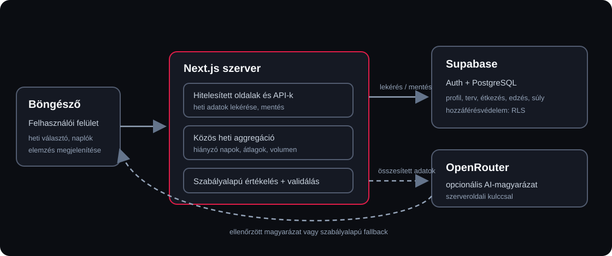

# Személyre szabott edzés- és táplálkozáskövető webalkalmazás fejlesztése
## Heti fejlődéselemzés strukturált naplóadatok és nagy nyelvi modell felhasználásával

**Szakdolgozat II. – első tartalmi munkaváltozat, 2026. október 22.**

**Szerző:** Almási Péter  
**Neptun-kód:** BC0GZD  
**Intézmény / kar / szak:** [kitöltendő a kari sablon szerint]  
**Témavezető:** Dr. Bilicki Vilmos

> Ez a változat kizárólag az október 22-i mérföldkőhöz szükséges problémafelvetést, követelményelemzést és rendszertervezést dolgozza ki. A tényleges oldalszámot a kari sablon, a betűméret, a sortávolság, a margók és a címlap határozza meg. A fejezeteket a hallgatónak a saját megvalósításával össze kell vetnie, és a tanszéki formai előírások szerint véglegesítenie kell.

---

## 1. Bevezetés

### 1.1. A probléma és indokoltsága

Az edzés és a táplálkozás tudatos követése több, egymással összefüggő adat rendszeres rögzítését igényli. Egy edzés értékeléséhez önmagában kevés annak ismerete, hogy a felhasználó megnyitott-e egy edzéstervet vagy bejelölte-e az edzést teljesítettként. A tényleges munkáról a gyakorlatok, az elvégzett sorozatok, az ismétlésszámok és az alkalmazott súlyok adnak részletesebb képet. A táplálkozási naplóban eközben az elfogyasztott ételek és azok tápértékei jelennek meg, a testsúlynapló pedig különböző időpontok méréseit tartalmazza. A felhasználónak ezekből kell megértenie, hogyan viszonyul a tényleges tevékenysége a saját céljához.

A nehézséget nem kizárólag az adatok mennyisége jelenti. A naplók gyakran hiányosak: előfordulhat, hogy egy napra nem került étkezés, egy tervezett gyakorlatot kihagytak, vagy csak egyetlen testsúlymérés áll rendelkezésre. Ha a hiányzó étkezési napokat nulla kalóriaként kezeljük, az átlag lefelé torzul. Ha a megtervezett edzést azonosnak vesszük a ténylegesen elvégzett edzéssel, akkor a teljesítési mutató nem tükrözi a naplót. Rövid adatsorból pedig nem indokolt tartós testsúlytrendet állítani. A rendszernek ezért különbséget kell tennie a hiányzó adat, a rögzített nulla érték, a terv és a tényleges teljesítés között.

A projekt kiinduló értéke az, hogy az edzéstervet, az edzésnaplót, a táplálkozási bejegyzéseket és a testsúlyméréseket közös heti nézetben kapcsolja össze. Így a felhasználónak nem kell külön felületekről kézzel összegyűjtenie az összehasonlításhoz szükséges adatokat. A rendszer nem állítja, hogy a piacon elérhető más alkalmazásoknál általánosságban jobb; a dolgozat vizsgált hozzájárulása a FitTrack Pro-ban megvalósított, adatokkal visszaellenőrizhető heti összesítés és az arra épített magyarázat.

A témavezető a projekt szakmai fókuszát a különálló modulok további bővítése helyett a személyes cél, a tényleges edzés, a táplálkozás és a testsúlyváltozás összekapcsolásában jelölte meg [6]. Ennek megfelelően a webshop a működő alkalmazás kiegészítő része, de nem a jelen dolgozatrész központi vizsgálati tárgya. A vizsgált fő felhasználói folyamat a személyes célok és terv kialakításától a naplózáson át a heti értékelés megtekintéséig tart.

### 1.2. Célkitűzés és vizsgálati kérdések

A dolgozat célja a FitTrack Pro olyan változatának megtervezése, megvalósítása és ellenőrizhető bemutatása, amely egy regisztrált felhasználó saját adataiból heti összesítést készít az edzésteljesítésről, az étkezési napló lefedettségéről, a kalória- és fehérjebevitelről, valamint a testsúlymérésekről. Az összesítéshez egy determinisztikus szabályalapú értékelés társul. Elérhető külső nyelvimodell-szolgáltatás esetén a rendszer ehhez külön AI által készített magyarázatot és következő heti javaslatokat is megjelenít.

A dolgozat a következő kérdéseket vizsgálja:

1. Hogyan lehet az edzéstervből, a tényleges edzésnaplóból, az étkezésekből és a testsúlymérésekből egységes, kézzel is ellenőrizhető heti mutatókat előállítani?
2. Hogyan kezelhetők a hiányzó vagy részleges naplóadatok úgy, hogy ne keveredjenek össze a nulla értékkel, és ne vezessenek félre a heti átlagok?
3. Milyen magyarázó többletet adhat a strukturált adatokból készített AI-válasz a szabályalapú összefoglalóhoz képest, és milyen működési, biztonsági és adatminőségi korlátokat kell bemutatni?

A dolgozatban az alkalmazás AI-funkcióját nem egészségügyi döntéshozóként kezelem. A vizsgálat tárgya az, hogy a nyelvi modell mennyire érthetően fogalmazza meg a rendszerben már összesített adatokat, és mennyire követi a megadott korlátokat. A nyers naplóadatok és a számított mutatók ellenőrizhetősége fontosabb, mint a modell szövegének meggyőző hangzása.

### 1.3. A rendszer hatóköre és korlátai

A dolgozat fő területe a profilhoz és célhoz kötött heti edzés- és táplálkozáskövetés, a részletes edzésnapló, a testsúlyadatok összesítése, valamint a szabályalapú és AI-alapú visszajelzés összevetése. A felhasználó gyakorlatokból edzéstervet állíthat össze, naplózhatja a tényleges sorozatokat, ismétléseket és súlyokat, étkezési adatokat rögzíthet, továbbá testsúlyméréseket vehet fel. A heti nézet a kiválasztott időszakot az azt megelőző héttel együtt mutatja.

A rendszer célértékeket becsül a profil megadott adataiból, de ezek nem klinikai mérések. A felület és az AI-kimenet nem helyettesít orvosi, dietetikusi vagy edzői tanácsadást. A rövid vagy hiányos napló nem teszi lehetővé az egészségi állapotra vonatkozó következtetést. A webshop, a fizetési folyamat, valamint az automatikus edzésterv-módosítás nem tartozik e dolgozatrész fő értékelési körébe.

## 2. Követelményelemzés

### 2.1. Szereplők és használati környezet

Az elsődleges szereplő a regisztrált felhasználó. Böngészőből eléri a saját profilját, edzéstervét, napi naplóit és fejlődési adatait. A felhasználó maga felel azért, hogy a rögzített étkezések és edzések a valós tevékenységét tükrözzék; az alkalmazás a megadott adatokból számol, és nem tudja ellenőrizni, hogy egy bejegyzés teljes-e.

Másodlagos szereplő az üzemeltető vagy fejlesztő, aki konfigurálja a Supabase projektet, alkalmazza az adatbázis-migrációkat, kezeli a mintaadatok létrehozását és szerveroldalon megadja a külső AI-szolgáltatás kulcsát. A gyakorlatkatalógus importált adatokat tartalmaz [5]. Az Open Food Facts szolgáltatás termékkeresési függőség, az AI-elemzés pedig az OpenRouter API-ján keresztül éri el az aktuálisan konfigurált nyelvimodell-szolgáltatót [3, 4]. Ezek elérhetősége és válaszformátuma nem a FitTrack Pro irányítása alatt áll.

### 2.2. Fő használati esetek

**HK-01 – Heti fejlődés áttekintése.** Előfeltétel a bejelentkezett felhasználói munkamenet. A felhasználó megnyitja a fejlődés oldalt, kiválaszt egy hetet, majd megtekinti az adott hét és az előző hét edzés-, táplálkozási és testsúlymutatóit. Ha nincs étkezési adat, az alkalmazás nem jelenít nulla kalóriát átlagként, hanem jelzi a naplólefedettséget. Ha nincs elegendő testsúlymérés, nem állít heti változást. Alternatív eset, hogy korábbi hét kiválasztásakor kevés adat áll rendelkezésre; ilyenkor az elérhető mérőszámok jelennek meg, a hiányzókat pedig adat hiányaként kell jelezni.

**HK-02 – Edzés rögzítése.** Előfeltétel egy aktív terv és az ahhoz tartozó edzésnap. A felhasználó megnyitja a naplózót, ellenőrzi vagy módosítja a tervezett gyakorlatok sorozatait, ismétléseit és súlyait, szükség esetén extra sorozatot ad hozzá, illetve kihagyottként jelöl egy gyakorlatot. Mentés után az adatok visszanézhetők. Sikertelen mentésnél a felületnek hibát kell jeleznie, és lehetőséget kell adnia az újrapróbálkozásra. A kihagyott gyakorlat nem számíthat bele az elvégzett volumenbe.

**HK-03 – Heti elemzés kérése.** Előfeltétel a hitelesített felhasználó és az aktuális hétre összegyűjthető adat. A szerver kiszámítja a heti mutatókat és a determinisztikus alaperedményt, majd megkísérli az AI-értékelés elkészítését. Siker esetén a kétféle eredmény egymás mellett jelenik meg. Külső szolgáltatási hiba vagy hibás AI-válasz esetén a szabályalapú összefoglaló marad használható, a korlátozott állapotot pedig jelezni kell. Ha az aktuális hétre már van elemzés, az ismételt kérés nem hozhat létre észrevétlenül duplikált eredményt.

### 2.3. Funkcionális követelmények

| Azonosító | Prioritás | Követelmény | Elfogadás ellenőrzése |
|---|---|---|---|
| K-01 | P0 | A felhasználó regisztrálhat, bejelentkezhet, és csak hitelesítés után használhatja a védett napló- és fejlődésfunkciókat. | Kézi bejelentkezési próba és jogosulatlan kérés ellenőrzése. |
| K-02 | P0 | A profil tárolja a cél- és energiaigény-becsléshez szükséges adatokat; a felhasználói cél jelenjen meg a heti értékelés bemenetében. | Profiladatok ellenőrzése és célérték számításának tesztesetei. |
| K-03 | P0 | A felhasználó aktív heti tervet állíthat össze gyakorlatokkal és edzésnapokkal. | Terv mentése, újranyitása és tervnapok megjelenése. |
| K-04 | P0 | Az edzésnapló sorozatonként tárolja a tényleges ismétlést és súlyt, támogatja az extra sorozatot és a gyakorlat kihagyását. | Mentés utáni újranyitás; a kihagyás és a volumen hatásának ellenőrzése. |
| K-05 | P0 | A felhasználó napi étkezéseket és azok tápértékadatait rögzítheti, valamint élelmiszerre kereshet. | Étkezés mentése és megjelenése a napi, illetve heti nézetben. |
| K-06 | P0 | A felhasználó dátumhoz kötött testsúlyméréseket rögzíthet. | Mérés mentése, dátum szerinti megjelenése és heti átlag ellenőrzése. |
| K-07 | P1 | A fejlődésoldalon hét választható; a kiválasztott hét mellett az azt megelőző hét összehasonlítható adatai jelennek meg. | A demo hetek és egy korábbi hét kézi kiválasztása. |
| K-08 | P1 | A heti összesítő a naplózott edzések, a részletes volumen, az étkezési lefedettség, a kalória- és fehérjeátlag, valamint a testsúlymérések mutatóit adja vissza. | A seeded teszthét eredményeinek kézi újraszámítása és összevetése. |
| K-09 | P1 | A rendszer a heti adatokból determinisztikus szabályalapú összefoglalót állít elő; AI elérhetősége esetén külön magyarázat is készül. | Azonos bemenet ismételt szabályalapú számítása, majd AI-eredmény ellenőrzése. |
| K-10 | P1 | AI-hiba vagy nem feldolgozható válasz esetén a szabályalapú értékelés maradjon elérhető, és a felület jelezze az AI állapotát. | Szolgáltatási hibát szimuláló tesztkörnyezetben fallback ellenőrzése. |
| K-11 | P1 | A korábbi heti elemzések visszakereshetők, dátumuk és eredetük azonosítható. | Előzménylista és minta-, szabályalapú, valamint AI-állapot ellenőrzése. |

A P0 jelölés az elsődleges felhasználói folyamat működéséhez szükséges követelményt, a P1 a heti összehasonlítás és értékelés szempontjából fontos funkciót jelöli. A követelményekhez rendelt elfogadási ellenőrzések a későbbi tesztjegyzőkönyv alapját adják; a táblázat nem állítja, hogy minden ellenőrzést már végrehajtottunk.

### 2.4. Minőségi követelmények, függőségek és korlátok

| Terület | Elvárás és ellenőrizhetőség |
|---|---|
| Adatkonzisztencia | A képernyőn látható heti mutatók és az elemzés bemenete azonos aggregációból származzon. Eltérő bemeneti adatok nélkül a szabályalapú eredmény legyen reprodukálható. |
| Hiányos adatok | A naplózatlan étkezési nap ne kerüljön nulla kalóriaként az átlagba. A lefedettség legyen látható; hiányzó testsúlytrend esetén a felület ne mutasson számított változást. |
| Hozzáférésvédelem | A védett adatokat hitelesítés és adatbázis-szintű RLS szabályozza. A jogosulatlan felhasználó ne férjen hozzá más profiljához vagy naplóihoz. |
| Titkok kezelése | Az OpenRouter- és Supabase emelt jogosultságú kulcsok szerveroldali környezetben maradjanak; ne kerüljenek klienskódba vagy a repositoryba. |
| Külső szolgáltatások | A Supabase, az Open Food Facts és az OpenRouter elérhetősége, korlátozásai és válaszai függőséget jelentenek. AI-hiba esetén a fő heti összesítő maradjon használható. |
| Használhatóság | A fő naplózási és heti áttekintési folyamat legyen magyar nyelvű, visszajelzést adó és különböző képernyőméretekre alkalmas. A reszponzivitást és az üres/sikeres/hibás állapotokat kézi felhasználói próbával kell dokumentálni. |
| Biztonságos értelmezés | A célértékek becslések; az AI nem adhat diagnózist, sérüléskezelési útmutatást vagy szélsőséges diétás javaslatot. Hiányos adatoknál a bizonytalanságot jelezni kell. |

A fő működési kockázat az adatok teljessége: a rendszer nem tud következtetni arra, amit a felhasználó nem rögzített. További függőség a külső AI-modell és annak szolgáltatója; a modellkatalógus, a hozzáférés és az esetleges díjazás változhat. Ezért az alkalmazás az AI-t nem tekinti a számított mutatók forrásának, és nem teszi az AI-választ a naplózás vagy a heti összesítő előfeltételévé. A termékkereséshez használt külső élelmiszeradatok hiányosak vagy eltérő mértékegységűek lehetnek; az adatbevitel ellenőrzése továbbra is a felhasználó feladata.

## 3. Rendszertervezési döntések

### 3.1. Architektúra és komponenshatárok

A FitTrack Pro Next.js App Routerre, Reactre és TypeScriptre épülő webalkalmazás. A böngésző a felhasználói felületet jeleníti meg; a Next.js szerveroldali része végzi a hitelesített adatok lekérését, a szerveroldali műveleteket és a Route Handlereken keresztüli API-kéréseket. A Supabase biztosítja az adatbázist és a hitelesítést. Az OpenRouterrel való kommunikáció kizárólag a szerveroldali elemző végponton történik. Ez a megosztás az interaktív felületet elkülöníti az érzékeny adatokat és titkokat kezelő logikától [1]. A saját rendszer konkrét komponenseit és adatútját a megvalósított forráskód alapján határoztam meg [8].

Az adatút fő lépéseit a 3.1. ábra szemlélteti.

<em>3.1. ábra. A heti értékelés magas szintű adatútja (saját szerkesztés).</em>

A böngésző hitelesített kérést küld a Next.js alkalmazásnak. A szerver a Supabase-ből lekéri az adott felhasználó profilját, aktív tervét, napi naplóit, testsúlyméréseit és részletes edzésnaplóit. A közös heti aggregáció előállítja az aktuális és az előző időszak mutatóit; ezekből determinisztikus szabályalapú értékelés készül. A szerver opcionálisan az aggregált bemenetet az OpenRouternek továbbítja, majd a választ ellenőrzi és eltárolja.

A Next.js szerver- és klienskomponensei eltérő feladatot látnak el: a szerverkomponensek alkalmasak adatlekérésre és szerveroldali erőforrások használatára, míg a klienskomponensek a felhasználói interakciót, például a hétválasztást és a napló szerkesztését kezelik [1]. Az edzésnapló mentése szerveroldali műveletet vesz igénybe; a heti összesítő és az elemzés API-végponton keresztül szolgálja ki a felületet.

### 3.2. Adatmodell és hozzáférésvédelem

Az adatmodell a felhasználói profilt elválasztja a terv- és naplóadatoktól. A `profiles` táblában találhatók a célhoz és becslésekhez szükséges felhasználói adatok. A `workout_plans` aktív terve `workout_days` napokon keresztül kapcsolódik a tervezett gyakorlatsorhoz. A tényleges napi teljesítést a `daily_logs` rögzíti; ehhez kapcsolódnak a `food_entries` bejegyzések és a `workout_exercise_logs` részletes gyakorlatnaplók. A testsúlymérések külön `weight_logs` rekordok. A generált heti eredményt a `weekly_analyses` tárolja, dátummal, állapottal, strukturált válasszal és az értékeléshez használt heti adatokkal.

Ez a felosztás külön kezeli a tervezett és a ténylegesen végzett tevékenységet, valamint megőrzi azt a forrást, amelyből a heti mutató számítható. A migrációk verziózott SQL-fájlokban rögzítik a sémaváltozásokat. A seed szkript ellenőrizhető demo profilt és két lezárt teszthetet hoz létre; használata kizárólag a demo felhasználóhoz kötődő adatokat érinti, ezért éles felhasználón nem alkalmazható.

A Supabase Auth azonosítja a felhasználót, a Row Level Security (RLS) pedig adatbázis-szinten korlátozza, hogy mely sorok érhetők el. A kliensoldali felület elrejtése nem helyettesítené ezt a védelmet: a jogosultsági ellenőrzést a szervernek és az adatbázisnak is érvényesítenie kell. A projekt RLS-szabályokat tartalmaz a felhasználói táblákhoz [2]. A végleges értékelési fejezetben külön rögzíteni kell a jogosulatlan hozzáférés próbájának tényleges eredményét. A seedeléshez szükséges emelt jogosultságú kulcs nem kerülhet a böngészőbe vagy a verziókezelőbe.

### 3.3. Heti összesítés és hiányzó adatok kezelése

A heti aggregációt a `src/lib/analysis/weekly-metrics.ts` valósítja meg. Ugyanez a modul szolgálja ki a fejlődésoldal heti összesítőjét és az elemzési végpontot, így a felület és az AI-nak küldött adatok ugyanazon számítási útvonalból készülnek. A hetek hétfőn kezdődnek; a folyamatban lévő hét vége nem lehet későbbi a lekérés napjánál. A kiválasztott hét összehasonlítási alapja a közvetlenül előtte lévő hét.

Az étkezési napok száma olyan naplózott napokból áll, amelyekhez legalább egy étkezési bejegyzés tartozik. A napi kalóriamennyiségek átlaga ezekre a napokra készül, nem a teljes hétre. Például öt, egyenként 2000 kcal-t tartalmazó naplózott nap és két hiányzó nap esetén az átlag 2000 kcal, a lefedettség pedig 5/7 nap. A fehérjeátlag azon napokból készül, ahol fehérjeadat is rendelkezésre áll; ez különbözhet az étkezési napok számától.

Az edzésteljesítés az aktív terv héten belülre eső edzésnapjainak számát hasonlítja a `workout_completed` értékkel rögzített napi teljesítésekhez. A részletes volumen a naplózott gyakorlatok ismétlésszámainak és hozzájuk tartozó súlyoknak szorzatösszege, azaz `Σ(ismétlés × súly)`. A kihagyott gyakorlatot a lekérdezés kizárja. Ez a mutató a naplózott terhelés leírására szolgál, nem az edzés élettani hatásának mérése.

A testsúly heti átlaga az adott időszakban rögzített mérésekből készül. Változás csak akkor számítható, ha a kiválasztott és az előző hét átlaga is rendelkezésre áll. A heti átlag és a mérési darabszám együtt jelenik meg, mert ugyanaz az átlag eltérő számú mérésből is előállhat.

### 3.4. Kalóriacél becslése

A kalóriacél-becslés a felhasználói profilban megadott adatokból indul ki, és a Mifflin–St Jeor-egyenletet alkalmazza a nyugalmi energiafelhasználás becslésére. Az egyenletet Mifflin és munkatársai egészséges felnőttek mérési adatai alapján tették közzé [7]. A FitTrack ezt az értéket aktivitási tényezővel módosítja, majd a felhasználó céljához igazított célértéket számít. Ha az alapadatok hiányoznak, nem áll rendelkezésre megbízható személyes célérték.

A számítás célja az alkalmazáson belüli összehasonlítás támogatása, nem pedig egyéni klinikai energiaigény meghatározása. Az egyenlet becslő jellegű, és a felhasználói adatok pontossága, a tényleges aktivitás, valamint más egyéni körülmények eltérést okozhatnak. Ezért a felület a célt becslésként kezeli, a dolgozat pedig nem következtet belőle egészségügyi állapotra.

### 3.5. Szabályalapú értékelés és AI-integráció

A heti értékelés első rétege a `src/lib/analysis/rule-summary.ts` modulban megvalósított determinisztikus függvény. Az edzés teljesítési arányát, a naplózott napok lefedettségét, a kalória- és fehérjeadatokat, a részletes volument és a testsúlymérések számát alakítja rövid megállapításokká és javaslatokká. A pontszám is rögzített szabályok szerint, korlátozott tartományban készül. Ez az alap akkor is előállítható, ha a külső AI-szolgáltatás nem érhető el.

A témavezető adaptív visszajelzésre vonatkozó javaslatához a rendszer a két legutóbbi, teljesen lezárt hét tervteljesítését is figyelembe veszi. Ha mindkét héten elmaradt a teljesítés a tervtől, az értékelés felveti a heti gyakoriság fenntarthatóságának átgondolását; két teljesített hét és részletes edzésnapló esetén legfeljebb egy tényező kis lépésű módosítását javasolja. A folyamatban lévő hét nem vált ki ilyen következtetést, és az alkalmazás egyik esetben sem módosítja automatikusan a felhasználó edzéstervét.

Az elemző API hitelesítés után összegyűjti a folyamatban lévő hét, valamint a két legutóbbi teljesen lezárt hét mutatóit, előállítja a szabályalapú eredményt, majd szerveroldali kérést küld az OpenRouter chat completion végpontjára [3]. A modell bemenete strukturált heti adat; az alkalmazás rendszerutasítása előírja az adatokhoz kötött válaszadást, a kizárólag magyar nyelvű kimenetet és az egészségügyi korlátokat. A szerver a visszakapott JSON-t feldolgozza, ellenőrzi a kötelező mezőket, a pontszám tartományát és a kimenet nyelvét. Szolgáltatási hiba vagy hibás formátumú, illetve nem magyar válasz esetén a determinisztikus eredmény használható marad. A felület a korábban elmentett, nyelvi ellenőrzésen fennakadó AI-szöveget is a szabályalapú magyar értékeléssel helyettesíti. Az AI-válasz nem módosítja a naplóadatokat, és nem hoz létre vagy ír át edzéstervet.

E döntés előnye, hogy a nyelvi modell szöveges magyarázata összevethető a rögzített szabályokkal, miközben a számítások a modell nélkül is ellenőrizhetők. Korlátja, hogy az AI válasza nem determinisztikus, a külső szolgáltató változhat vagy kieshet, illetve a modell a korlátozó utasítások ellenére is adhat nem megfelelő szöveget. Ezért a modell kimenete csak validálás után jelenhet meg; a dolgozat későbbi tesztelési fejezetében a sikeres választ és a fallbackot külön kell vizsgálni.

## Hivatkozások

[1] Vercel: *Next.js Documentation – Server and Client Components*. https://nextjs.org/docs/app/getting-started/server-and-client-components (letöltve: 2026. 10. 21.).

[2] Supabase: *Row Level Security*. https://supabase.com/docs/guides/database/postgres/row-level-security (letöltve: 2026. 10. 21.).

[3] OpenRouter: *Create a chat completion*. https://openrouter.ai/docs/api/api-reference/chat/send-chat-completion-request (letöltve: 2026. 10. 21.).

[4] Open Food Facts: *API documentation*. https://openfoodfacts.github.io/documentation/docs/Product-Opener/api/ (letöltve: 2026. 10. 21.).

[5] wger project: *Using the API*. https://wger.readthedocs.io/en/latest/api/api.html (letöltve: 2026. 10. 21.).

[6] Bilicki Vilmos (2026. 06. 26.): témavezetői e-mail a FitTrack Pro szakdolgozati fókuszáról és a javasolt fejlesztési irányokról. Nem publikált levelezés.

[7] Mifflin, M. D. et al. (1990): *A new predictive equation for resting energy expenditure in healthy individuals*. The American Journal of Clinical Nutrition, 51(2), 241–247. DOI: 10.1093/ajcn/51.2.241. https://pubmed.ncbi.nlm.nih.gov/2305711/.

[8] Almási Péter (2026): *FitTrack Pro* forráskódja és projekt dokumentációja. Saját fejlesztésű szoftver. https://github.com/Almasip442/FitTrack.
